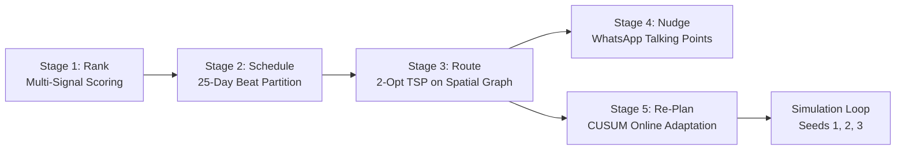

# PJP AI Developer Skill

This skill guides the design, mathematical formulation, spatial graph routing, and dynamic online re-planning for the Permanent Journey Plan (PJP) proof-of-concept.

## Environment & Execution
Always execute scripts using the verified Python 3.11 launcher:
```powershell
py -3.11 <script_name>.py
```
Key libraries: `networkx 3.6.1`, `pandas 2.3.3`, `openpyxl 3.1.5`, `matplotlib 3.10.8`.

---

## 1. Algorithmic Pipeline Overview (5 Stages)

Refer to:
* [Scoring Matrix & Weights](./references/scoring_matrix.md)
* [Graph Routing Specification](./references/graph_routing_spec.md)
* [Re-plan Protocol](./references/replan_protocol.md)



---

## 2. Step-by-Step Runbook

### Stage 1 & 2: Focus Selection & Beat Scheduling
Generate the ranked focus accounts and assign them across 25 working days in November 2026:
```powershell
py -3.11 .agents/skills/pjp-ai-developer/scripts/rank_and_schedule.py
```
* **Rules Enforced:**
  * 150 visit slots per SO ($25 \times 6$).
  * Loyalty club dealers receive exactly 2 visits spaced $\ge 10$ working days apart.
  * Non-club focus dealers receive exactly 1 visit.
  * High-value de-growing accounts prioritized in Working Days 1 to 10.
  * Max 1 unlocated dealer per day.

### Stage 3: Spatial Graph TSP Routing
Sequence daily stops using 2-opt TSP heuristics on `G_tour` from the SO's day-start coordinate:
```powershell
py -3.11 .agents/skills/pjp-ai-developer/scripts/route_tsp_solver.py
```
* **Output:** `plan_november.csv` matching simulator format (`date, so_id, sequence, account_id, account_type`).
* **Physics:** Haversine $\times 1.35$ detour factor, 18 km/h (metro) / 30 km/h (upcountry). Fits within the 460-minute net focus budget.

### Stage 4: WhatsApp Nudge Generator
Generate 5+ data-backed talking points for the evening before each visit:
```powershell
py -3.11 .agents/skills/pjp-ai-developer/scripts/generate_nudges.py
```
* Under 300 characters each; grounded in loyalty slab gaps, tier drops, or headroom.

### Stage 5: Dynamic Online Re-planner
Implements the simulator contract (`--state`, `--plan`, `--out`):
```powershell
py -3.11 .agents/skills/pjp-ai-developer/scripts/dynamic_replan.py --state STATE.json --plan CURRENT_PLAN.csv --out NEXT_PLAN.csv
```
* **Drop Recovery:** Online CUSUM detector detects drops on active accounts ($f \le 0.35$); inserts visit within 7 days.
* **Hike Cancellations:** Cancels visits during 10-day spike windows ($f \ge 2.0$) to gain Hike Handling points.
* **Weather Forecast:** Limits rain/traffic days to 5 visits, keeping club visits intact.
* **Hard Guardrails:** Ensures 0 breaches (no day $> 6$, no dealer $> 2$, execution $< 15$ seconds).

### Stage 6: Multi-Seed Benchmark Evaluation
Execute `simulate.py` across practice seeds 1, 2, and 3:
```powershell
py -3.11 .agents/skills/pjp-ai-developer/scripts/run_seed_benchmark.py
```
* Verifies Adherence $\ge 90\%$, Coverage $\ge 95\%$, Drop Response $\ge 70\%$, and 0 breaches.
