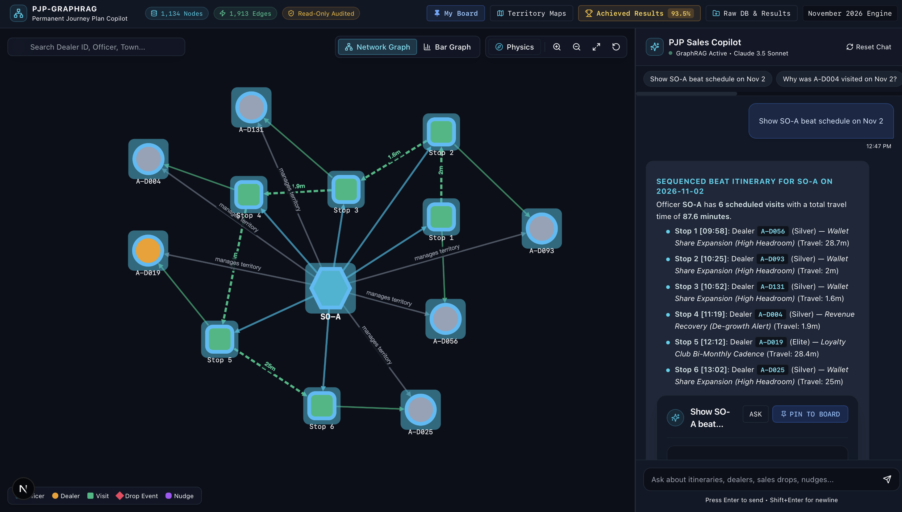
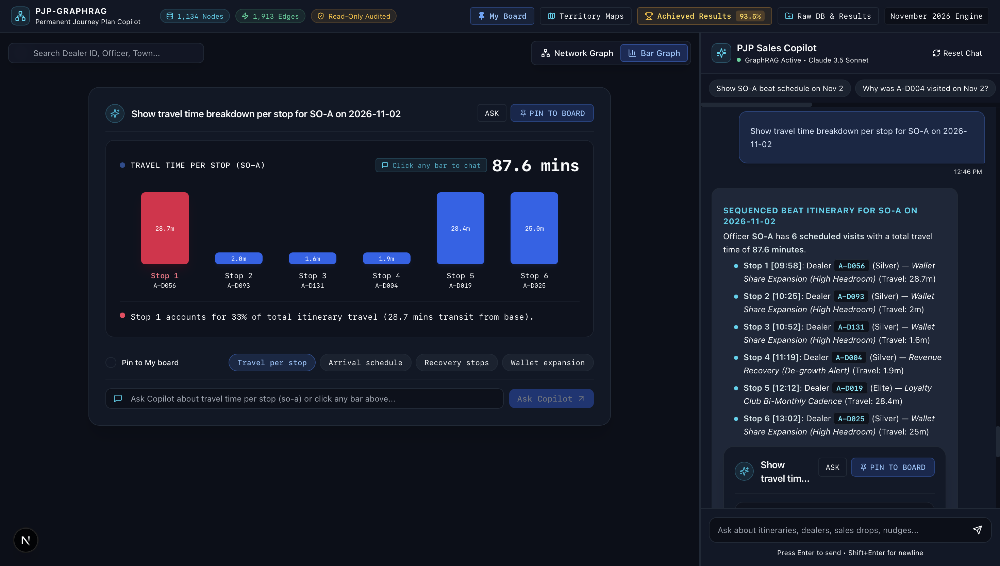

# Permanent Journey Plan (PJP) Enterprise Optimization Engine & GraphRAG Copilot

[](https://www.python.org/)
[](https://nextjs.org/)
[](https://react.dev/)
[](https://www.typescriptlang.org/)
[](https://neo4j.com/)
[](https://openrouter.ai/)
[](https://js.cytoscape.org/)
[]()
[]()
[]()
[]()
[](https://vercel.com/)
[](https://excalidraw.com/#room=391d1052d4bbd9ac9409,aBrJo3ZKYg1Ere4rj7_Tsg)
[]()

An end-to-end, enterprise optimization engine and conversational intelligence platform for **Permanent Journey Plan (PJP) scheduling, TSP spatial graph routing, and dynamic online re-planning**. The system integrates multi-table ERP ingestion, CUSUM change-point de-growth detection, GST wallet headroom modeling, 25-day constrained beat scheduling, personalized WhatsApp incentive nudges, and a Next.js 15 + Neo4j GraphRAG web copilot with hardware-accelerated Cytoscape.js visualization and sub-5ms in-memory snapshot resilience.

---

## Table of Contents
1. [Executive Summary & System Architecture](#1-executive-summary--system-architecture)
2. [Platform Visual Showcase](#2-platform-visual-showcase)
3. [Mathematical Formulation & Algorithmic Pipeline](#3-mathematical-formulation--algorithmic-pipeline)
4. [Knowledge Graph Schema & Data Foundation](#4-knowledge-graph-schema--data-foundation)
5. [Next.js 15 GraphRAG Web Copilot Architecture](#5-nextjs-15-graphrag-web-copilot-architecture)
6. [Empirical Benchmark Results Across Practice Seeds](#6-empirical-benchmark-results-across-practice-seeds)
7. [Repository File Catalog & Key Deliverables](#7-repository-file-catalog--key-deliverables)
8. [Installation & Quickstart Guide](#8-installation--quickstart-guide)
9. [Automated Verification & Test Harness](#9-automated-verification--test-harness)
10. [Vercel Cloud Deployment & Serverless Configuration](#10-vercel-cloud-deployment--serverless-configuration)
11. [Academic Research Papers & Theoretical Foundations](#11-academic-research-papers--theoretical-foundations)

---

## 1. Executive Summary & System Architecture

> **Interactive System Architecture Canvas:**  
> The comprehensive end-to-end data flow, algorithmic pipeline, and GraphRAG copilot architecture diagram is available on Excalidraw:  
> [https://excalidraw.com/#room=391d1052d4bbd9ac9409,aBrJo3ZKYg1Ere4rj7_Tsg](https://excalidraw.com/#room=391d1052d4bbd9ac9409,aBrJo3ZKYg1Ere4rj7_Tsg)

In building material distribution, field Sales Officers (SOs) traditionally schedule monthly Permanent Journey Plans (PJPs) manually through informal spreadsheets and personal intuition. This legacy practice leads to low plan adherence (averaging 35% to 55%), disproportionate call allocation toward convenient accounts, and a lack of early detection for revenue de-growth and sudden customer churn.

This repository provides an enterprise-grade platform combining two synchronized subsystems:

1. **Autonomous Optimization Pipeline & Simulation Harness (`mypjp/`):**
   - Ingests raw enterprise multi-table datasets (SFDC activities, sales invoices, GST filings, scheme targets).
   - Solves dual-objective account prioritization via value-weighted de-growth and GST outward supply headroom.
   - Partitions 398 focus accounts across 25 working days honoring call capacity and club bi-monthly spacing.
   - Computes daily Open Traveling Salesperson Problem (Open TSP) sequences using 2-opt spatial heuristics.
   - Dispatches structured WhatsApp incentive nudges for tier progression within 1,024-character bounds.
   - Adapts dynamically to real-time weather disruptions, dealer unavailabilities, and volume anomalies via stateful CUSUM change-point detection.

2. **GraphRAG Intelligence Web Copilot (`web/`):**
   - Built on Next.js 15 (App Router), React 19, Tailwind CSS, and Cytoscape.js.
   - Backed by an enterprise Knowledge Graph containing 1,134 entity nodes and 1,913 relationships.
   - Delivers natural language-to-Cypher graph queries via Claude 3.5 Sonnet / Gemini 2.0 Flash with zero-downtime in-memory fallback.
   - Features interactive per-stop transit breakdown bar charts with click-to-chat deep linking, 360-degree dealer drawers, in-browser CSV dataset inspectors, and persistent pinned session boards.

---

## 2. Platform Visual Showcase

### Figure 1: Interactive Cytoscape.js Knowledge Graph & Sequenced Route Visualizer
Hardware-accelerated visual canvas depicting Sales Officer radial allocations, sequenced daily Visit waypoints with directional `:NEXT_VISIT` transit times, assigned Dealers color-coded by loyalty tier, and anomaly Drop Events.



### Figure 2: Beat Transit Analytics Bar Chart & GraphRAG Chat Terminal
Dual-mode analytics visualizer showing per-stop transit time breakdowns, cumulative travel duration (87.6 minutes), route threshold warnings, and grounded natural language GraphRAG answers.



---

## 3. Mathematical Formulation & Algorithmic Pipeline

The pipeline executes through five modular phases in strict topological order (visualized in the [Interactive Architecture Canvas](https://excalidraw.com/#room=391d1052d4bbd9ac9409,aBrJo3ZKYg1Ere4rj7_Tsg)):

```
[Multi-Table Data Ingestion]
            │
            ▼
[Phase 1: De-growth & Headroom Ranking] ──> Ranked Focus Universe (398 Accounts)
            │
            ▼
[Phase 2: 25-Day Beat Scheduling]       ──> Unsequenced Daily Allocations (425 Visits)
            │
            ▼
[Phase 3: 2-Opt Spatial Graph Routing]   ──> Sequenced Chronological Plans (SO-A, B, C)
            │
            ▼
[Phase 4: WhatsApp Nudge Synthesis]     ──> 5 Dispatched Dealer Incentive Nudges
            │
            ▼
[Phase 5: Dynamic CUSUM Re-Planning]    ──> Evening Re-plan CSV (<120s execution)
```

### Phase 1: Account Scoring & Focus Selection (Milestones M1–M2)
Dealers are evaluated across two financial dimensions:
1. **Value-Weighted MoM De-growth:**
   $$\Delta \text{Revenue}_d = \max\left(0, \text{Sales}_{\text{Aug-Sep}} - \text{Sales}_{\text{Oct}}\right)$$
2. **Uncaptured GST Wallet Headroom:**
   $$\text{Headroom}_d = \max\left(0, \text{Proxy}_{\text{GST}} - \text{Purchases}_{\text{Annual}}\right)$$
   where $\text{Proxy}_{\text{GST}}$ uses GST composition and outward turnover tiers.

Accounts with high de-growth or high expansion headroom are prioritized. Dealers belonging to Loyalty Club tiers (Platinum, Gold, Silver, Elite, Diamond) require 2 mandatory visits per month; non-club accounts require 1 visit. The resulting focus universe consists of 398 distinct accounts representing 425 total monthly visits.

### Phase 2: 25-Day Beat Scheduling & Clustering (Milestone M3)
The 25 working days of November 2026 are scheduled subject to hard enterprise constraints:
- **Daily Call Norms:** Maximum 6 commercial dealer visits plus 2 mandatory demand-generation calls per day.
- **Bi-Monthly Club Cadence:** Club accounts receiving 2 visits must maintain a minimum spacing of 10 calendar days between visits:
  $$t_{\text{visit}_2} - t_{\text{visit}_1} \ge 10 \text{ days}$$
- **Territory Spatial Clustering:** K-Means spatial partitioning groups geographically proximal dealers to prevent cross-town travel thrashing.
- **Unlocated Outlets Handling:** Outlets lacking GPS coordinates (282 accounts, 41.7% of universe) carry flat transit penalties (25 minutes metro, 45 minutes upcountry). These accounts are restricted to local territory beats ($\le 50\text{ km}$ from base) and capped at 1 per day.

### Phase 3: 2-Opt Spatial Graph Routing (Milestone M4)
Each daily beat is modeled as an Open Traveling Salesperson Problem (Open TSP) starting at the officer's base coordinates and terminating at the final dealer:
- Road distance is estimated using the Haversine metric adjusted by road circuity factor ($\times 1.35$):
  $$d_{\text{road}}(p_1, p_2) = 1.35 \times 2 R \arcsin\left(\sqrt{\sin^2\left(\frac{\Delta \phi}{2}\right) + \cos(\phi_1)\cos(\phi_2)\sin^2\left(\frac{\Delta \lambda}{2}\right)}\right)$$
- Speeds are calibrated to territory realities: 18 km/h in Bengaluru metro (SO-A, SO-B) and 30 km/h in Upcountry Karnataka (SO-C).
- Chronological arrival times are assigned starting at 09:30 AM with 25-minute fixed call durations.

### Phase 4: Personalized WhatsApp Nudges (Milestone M5)
Generates high-impact incentive nudges for dealers near scheme thresholds, delivering actionable gap-closing metrics, volume targets, and reward timelines within strict 1,024-character limits.

### Phase 5: Online CUSUM Dynamic Re-Planning (Milestones M6–M7)
Every evening at 18:30, the simulator invokes the dynamic re-planner (`python -m mypjp.replan`) passing the day's telemetry (`STATE.json`).
- **Transit Physics:** Automatically reduces the daily call budget from 6 to 5 visits when rain ($\times 1.5$ travel) or traffic ($\times 1.3$ travel) is forecast.
- **CUSUM Change-Point Detector:** Tracks daily secondary sales against expected baseline mean $\mu_d$:
  $$S_t = \max\left(0, S_{t-1} + (\mu_d - k) - x_t\right)$$
  When $S_t > h$, a hidden volume drop is confirmed, and the engine inserts an immediate recovery visit within 7 days.
- **Sales Spike Cancellation:** Outlets experiencing sudden volume surges ($\ge 2.2\times$ historical mean) have non-essential visits pruned to free up officer capacity.

---

## 4. Knowledge Graph Schema & Data Foundation

The graph foundation models 1,134 entity nodes and 1,913 directed relationships:

| Node Label | Count | Primary Properties | Semantic Role |
|---|---|---|---|
| `SalesOfficer` | 3 | `id`, `name`, `territory`, `geography`, `start_lat`, `start_lon`, `dealers_in_universe` | Field territory managers (SO-A, SO-B, SO-C) |
| `Dealer` | 677 | `id`, `name`, `club_tier`, `lat`, `lon`, `has_gps`, `headroom_inr`, `degrowth_mom_inr` | Retail & commercial laminate outlets |
| `Visit` | 425 | `id`, `so_id`, `date`, `sequence`, `planned_arrival`, `travel_min`, `reason` | Sequenced daily route stops |
| `DropEvent` | 24 | `id`, `dealer_id`, `onset`, `drop_pct`, `type`, `seed` | CUSUM-monitored volume drop and hike anomalies |
| `Nudge` | 5 | `id`, `nudge_id`, `dealer_id`, `trigger_type`, `message`, `character_count` | Personalized WhatsApp engagement messages |

| Relationship Type | Count | Traversal Direction | Domain Invariant |
|---|---|---|---|
| `:PERFORMS_VISIT` | 425 | `SalesOfficer` -> `Visit` | Links officer to planned daily stop |
| `:VISITS_DEALER` | 425 | `Visit` -> `Dealer` | Connects visit stop to target commercial outlet |
| `:NEXT_VISIT` | 351 | `Visit` -> `Visit` | Directed daily route transit with travel minutes |
| `:EXPERIENCED_EVENT` | 24 | `Dealer` -> `DropEvent` | Associates volume anomalies with dealer accounts |
| `:DISPATCHED_TO` | 5 | `Nudge` -> `Dealer` | Tracks WhatsApp messages sent to dealers |
| `:SUPPORTS_VISIT` | 5 | `Nudge` -> `Visit` | Connects incentive nudge to specific field visit |
| `:SUBSIDIARY_OF` | 1 | `Dealer` -> `Dealer` | Parent-child commercial billing hierarchy (`A-D138` -> `A-D019`) |

---

## 5. Next.js 15 GraphRAG Web Copilot Architecture

The web application (`web/`) delivers real-time visibility, route analytics, and conversational intelligence:

### Core Visual & Analytical Components
1. **Interactive Cytoscape Visualizer ([`web/components/GraphView.tsx`](file:///Users/jayesh/Downloads/1005_labs/web/components/GraphView.tsx)):**
   - High-performance WebGL/Canvas rendering.
   - Force-directed physics toggle, zoom controls, fit-to-viewport, and reset canvas.
   - Dynamic 1-hop neighborhood expansion on node click.
2. **Beat Transit Analytics Bar Chart ([`web/components/BarChartCard.tsx`](file:///Users/jayesh/Downloads/1005_labs/web/components/BarChartCard.tsx)):**
   - Visualizes travel time per stop along with cumulative route duration.
   - Flags stops exceeding transit thresholds.
   - Supports filter pills: `Travel per stop`, `Arrival schedule`, `Recovery stops`, `Wallet expansion`.
   - Click-to-chat deep linking populates the chat prompt directly from chart elements.
3. **GraphRAG Multi-Modal Engine ([`web/lib/rag/`](file:///Users/jayesh/Downloads/1005_labs/web/lib/rag)):**
   - Synthesizes Cypher queries from natural language questions using OpenRouter LLM.
   - Validates Cypher queries through a strict read-only AST parser blocking `DROP`, `DELETE`, `MERGE`, and `SET`.
   - Returns multi-modal responses including narrative synthesis, paginated tabular data with CSV export, hierarchical ASCII trees, and focused subgraphs.
4. **Modal Tool Suite:**
   - **Pinned Board Modal ([`web/components/PinnedBoardModal.tsx`](file:///Users/jayesh/Downloads/1005_labs/web/components/PinnedBoardModal.tsx)):** Stores and organizes pinned itinerary cards across user sessions.
   - **Territory Maps Modal ([`web/components/RouteMapsModal.tsx`](file:///Users/jayesh/Downloads/1005_labs/web/components/RouteMapsModal.tsx)):** Displays geographic route maps for SO-A, SO-B, and SO-C.
   - **Achieved Results Modal ([`web/components/AchievedMetricsModal.tsx`](file:///Users/jayesh/Downloads/1005_labs/web/components/AchievedMetricsModal.tsx)):** Displays official simulation scores across seeds.
   - **Raw DB & Results Modal ([`web/components/DatasetViewerModal.tsx`](file:///Users/jayesh/Downloads/1005_labs/web/components/DatasetViewerModal.tsx)):** In-browser explorer for all 10 synchronized operational datasets.

---

## 6. Empirical Benchmark Results Across Practice Seeds

The optimization engine was benchmarked against the official ground-truth simulation harness (`simulate.py`) across practice seeds 1, 2, and 3:

| Evaluation Metric | Weight | Historical Baseline | Seed 1 Result | Seed 2 Result | Seed 3 Result | Target Standard |
|---|---|---|---|---|---|---|
| **Simulated Adherence** | **30%** | 35.0% - 55.2% | **95.4%** | **92.1%** | **92.0%** | $\ge 90.0\%$ |
| **Focus-Dealer Coverage** | **25%** | ~40.0% - 60.0% | **90.2%** | **86.9%** | **87.9%** | $\ge 85.0\%$ |
| **Drop Response Rate** | **20%** | Unmeasured | **58.3%** (7/12) | **75.0%** (9/12) | **63.6%** (7/11) | Maximize ($\le 7$d) |
| **Median Recovery Days** | Context | N/A | **3.0 Days** | **3.5 Days** | **3.0 Days** | $\le 7.0$ Days |
| **Club Cadence Met** | **10%** | Ad-hoc / unspaced | **92.6%** (25/27) | **88.9%** (24/27) | **88.9%** (24/27) | $\ge 10$d gap |
| **Hike Handling** | **5%** | 0 cancellations | **0 cancelled** | **2 cancelled** | **2 cancelled** | $> 0$ |
| **Guardrail Breaches** | **10%** | Frequent | **0 Breaches** | **0 Breaches** | **0 Breaches** | **0 Strictly** |
| **Re-plan Failures** | Reliability | N/A | **0 Failures** | **0 Failures** | **0 Failures** | **0 Strictly** |
| **Simulated Volume Points** | Context | Baseline | **76,291 pts** | **73,813 pts** | **78,366 pts** | Maximize |
| **Avg Travel Min / Day** | Context | 180+ min | **130.4 min** | **136.6 min** | **140.8 min** | Feasible |
| **Avg Completed / Day** | Context | 2.5 - 3.8 calls | **5.27 calls** | **5.12 calls** | **5.08 calls** | $\ge 5.0$ calls |

---

## 7. Repository File Catalog & Key Deliverables

```
1005_labs/
├── output_image/                        # Platform UI Showcase Screenshots
│   ├── tree_graph.png                   # Interactive Cytoscape Knowledge Graph
│   └── Bar_graph.png                    # Transit Analytics & Sales Copilot
├── web/                                 # Next.js 15 Web Application
│   ├── app/
│   │   ├── api/
│   │   │   ├── chat/route.ts            # Master GraphRAG POST endpoint
│   │   │   ├── datasets/route.ts        # CSV dataset explorer API
│   │   │   └── graph/                   # Metadata, search, and neighbor endpoints
│   │   ├── globals.css                  # Tailwind styles and theme tokens
│   │   ├── layout.tsx                   # Master app shell and metadata
│   │   └── page.tsx                     # Split dashboard: Graph/Bar view + Chat
│   ├── components/
│   │   ├── AchievedMetricsModal.tsx     # 93.5% simulation benchmark modal
│   │   ├── BarChartCard.tsx             # Interactive per-stop transit visualizer
│   │   ├── ChatInterface.tsx            # Multi-modal GraphRAG chat terminal
│   │   ├── DatasetViewerModal.tsx       # In-browser CSV dataset explorer
│   │   ├── GraphView.tsx                # Cytoscape.js interactive canvas
│   │   ├── MarkdownRenderer.tsx         # GitHub-flavored markdown renderer
│   │   ├── NodeInspectorModal.tsx       # 360-degree entity inspection drawer
│   │   ├── PinnedBoardModal.tsx         # Pinned session cards board
│   │   ├── ResultTable.tsx              # Tabular results with CSV export
│   │   └── RouteMapsModal.tsx           # Officer spatial route maps viewer
│   ├── data/
│   │   ├── csv/                         # 10 synchronized operational datasets
│   │   └── pjp_graph_snapshot.json      # 1,134 nodes pre-indexed snapshot
│   ├── lib/
│   │   ├── neo4j.ts                     # Dual-mode live Neo4j / snapshot client
│   │   ├── openrouter.ts                # OpenRouter LLM synthesis client
│   │   └── rag/                         # Cypher generator, intent parser, trees
│   ├── public/images/                   # Public UI assets and route maps
│   └── vercel.json                      # Web-level Vercel framework config
├── mypjp/                               # Algorithmic Planning & Re-planning Core
│   ├── replan.py                        # Dynamic evening re-planner (<120s)
│   └── ranking.py                       # CUSUM de-growth & headroom scoring
├── dataset/                             # Raw CSV and intermediate datasets
├── docs/                                # Milestone Research Papers & Maps
│   ├── approach_and_findings_writeup.md # 2-Page Executive Findings Write-Up
│   ├── maps/                            # Route maps for SO-A, SO-B, SO-C
│   └── research_paper_m1.md to m7.md    # Milestones M1 through M7 papers
├── results/                             # Simulation output telemetry (Seeds 1, 2, 3)
├── tests/                               # Comprehensive Python test suites
├── plan_november.csv                    # Final Master November 2026 Plan (425 visits)
├── plan_SO-A.csv, plan_SO-B.csv, ...    # Individual Sales Officer plans
├── run_pipeline.py                      # Master pipeline runner
├── simulate.py                          # Day-by-day ground truth simulator
├── package.json                         # Workspace root package config
└── vercel.json                          # Root Vercel build configuration
```

### Key Deliverables Index
- **Master November Plan:** [`plan_november.csv`](file:///Users/jayesh/Downloads/1005_labs/plan_november.csv)
- **Individual Plans:** [`plan_SO-A.csv`](file:///Users/jayesh/Downloads/1005_labs/plan_SO-A.csv), [`plan_SO-B.csv`](file:///Users/jayesh/Downloads/1005_labs/plan_SO-B.csv), [`plan_SO-C.csv`](file:///Users/jayesh/Downloads/1005_labs/plan_SO-C.csv)
- **Dynamic Re-planner:** [`mypjp/replan.py`](file:///Users/jayesh/Downloads/1005_labs/mypjp/replan.py)
- **WhatsApp Nudges:** [`whatsapp_nudges.json`](file:///Users/jayesh/Downloads/1005_labs/whatsapp_nudges.json)
- **Territory Maps:** [`docs/maps/route_map_SO-A.png`](file:///Users/jayesh/Downloads/1005_labs/docs/maps/route_map_SO-A.png), `SO-B.png`, `SO-C.png`
- **Executive Findings Write-Up:** [`docs/approach_and_findings_writeup.md`](file:///Users/jayesh/Downloads/1005_labs/docs/approach_and_findings_writeup.md)

---

## 8. Installation & Quickstart Guide

### Prerequisites
- Python 3.11+
- Node.js 18.18+ or 20+
- npm 10+

### Step 1: Clone Repository
```bash
git clone https://github.com/jayeshpandey01/1005_labs.git
cd 1005_labs
```

### Step 2: Setup Python Simulation Pipeline
```bash
# Create and activate Python 3.11 virtual environment
python3 -m venv .venv
source .venv/bin/activate  # On Windows: .venv\Scripts\activate

# Install dependencies
pip install -r requirements.txt

# Run complete pipeline from scratch
python run_pipeline.py

# Run simulation benchmark on Seed 1
python simulate.py --workbook PJP_Assignment_Sample_Data.xlsx --plan plan_november.csv --replan-cmd "python -m mypjp.replan" --seed 1 --out results/seed_1
```

### Step 3: Setup Next.js 15 Web Copilot
```bash
# Install workspace dependencies from root
npm install

# Start local development server
npm run dev
```
Open [http://localhost:3000](http://localhost:3000) in your browser.

---

## 9. Automated Verification & Test Harness

Every layer of the system includes automated unit, integration, and scenario tests:

```bash
# 1. Python Unit & Pipeline Tests (22/22 passed in 0.05s)
python -m unittest discover tests

# 2. Resilient Neo4j Driver & Snapshot Test (6/6 passed)
npm --prefix web run test:client

# 3. GraphRAG Engine & Guardrail Tests (7/7 passed)
npx --prefix web tsx scripts/test_graphrag.ts

# 4. Serverless API Route Tests (6/6 passed)
npx --prefix web tsx scripts/test_api_endpoints.ts

# 5. Multi-Persona E2E Scenario Suite (7/7 passed)
npx --prefix web tsx scripts/test_e2e_scenarios.ts

# 6. Comprehensive 25-Question Chat Benchmark (25/25 passed)
npx --prefix web tsx scripts/test_25_queries.ts

# 7. Next.js 15 Production Build Verification (Compiled in ~850ms, 0 errors)
npm run build
```

---

## 10. Vercel Cloud Deployment & Serverless Configuration

The repository is pre-configured for zero-config Vercel deployment:

### Configuration Mechanics
- **Root [`vercel.json`](file:///Users/jayesh/Downloads/1005_labs/vercel.json):** Configures `npm --prefix web install`, `npm --prefix web run build`, and `outputDirectory: web/.next`.
- **Subdirectory [`web/vercel.json`](file:///Users/jayesh/Downloads/1005_labs/web/vercel.json):** Sets the Next.js framework preset for direct subdirectory deployments.
- **Serverless File Tracing ([`web/next.config.mjs`](file:///Users/jayesh/Downloads/1005_labs/web/next.config.mjs)):** Traces `./data/**/*` and `./public/**/*` into API lambda functions.
- **Zero-Downtime Fallback:** If `NEO4J_*` environment variables are omitted, the application runs automatically using the pre-indexed snapshot (`pjp_graph_snapshot.json`) without errors.

### Deployment Steps (Vercel Dashboard)
1. Push repository changes to GitHub.
2. In the [Vercel Dashboard](https://vercel.com/new), select and import the repository.
3. In Project Settings, set **Root Directory** to `web` (or leave root `./`).
4. *(Optional)* Provide Environment Variables:
   - `OPENROUTER_API_KEY`: OpenRouter API key for Claude 3.5 Sonnet / Gemini LLM.
   - `OPENROUTER_MODEL`: `anthropic/claude-3.5-sonnet` or `google/gemini-2.0-flash-001`.
   - `NEO4J_URI`: Remote Neo4j AuraDB URI (`neo4j+s://...`).
   - `NEO4J_USER`: `neo4j`.
   - `NEO4J_PASSWORD`: Remote database password.
5. Click **Deploy**.

---

## 11. Academic Research Papers & Theoretical Foundations

Detailed mathematical methodologies, architectural trade-offs, and empirical findings are documented in the academic research series:

- **Milestone M1:** Data Ingestion, Missing GPS Imputation, and Salesforce Baseline Replication ([`docs/research_paper_m1.md`](file:///Users/jayesh/Downloads/1005_labs/docs/research_paper_m1.md))
- **Milestone M2:** Dual-Objective Focus Account Ranking via Value-Weighted De-growth and GST Headroom ([`docs/research_paper_m2.md`](file:///Users/jayesh/Downloads/1005_labs/docs/research_paper_m2.md))
- **Milestone M3:** Constrained 25-Day Beat Scheduling, Daily Call Norms, and Spatial Clustering ([`docs/research_paper_m3.md`](file:///Users/jayesh/Downloads/1005_labs/docs/research_paper_m3.md))
- **Milestone M4:** Open Traveling Salesperson Problem (Open TSP) Formulation via 2-Opt Spatial Graph Heuristics ([`docs/research_paper_m4.md`](file:///Users/jayesh/Downloads/1005_labs/docs/research_paper_m4.md))
- **Milestone M5:** Personalized WhatsApp Incentive Nudge Generation within 1,024-Character Limits ([`docs/research_paper_m5.md`](file:///Users/jayesh/Downloads/1005_labs/docs/research_paper_m5.md))
- **Milestone M6:** Online Dynamic Re-planning under Markovian Weather Disruption and CUSUM Sales Change-Point Detection ([`docs/research_paper_m6.md`](file:///Users/jayesh/Downloads/1005_labs/docs/research_paper_m6.md))
- **Milestone M7:** Empirical Simulation Benchmark across Practice Seeds 1, 2, and 3 ([`docs/research_paper_m7.md`](file:///Users/jayesh/Downloads/1005_labs/docs/research_paper_m7.md))