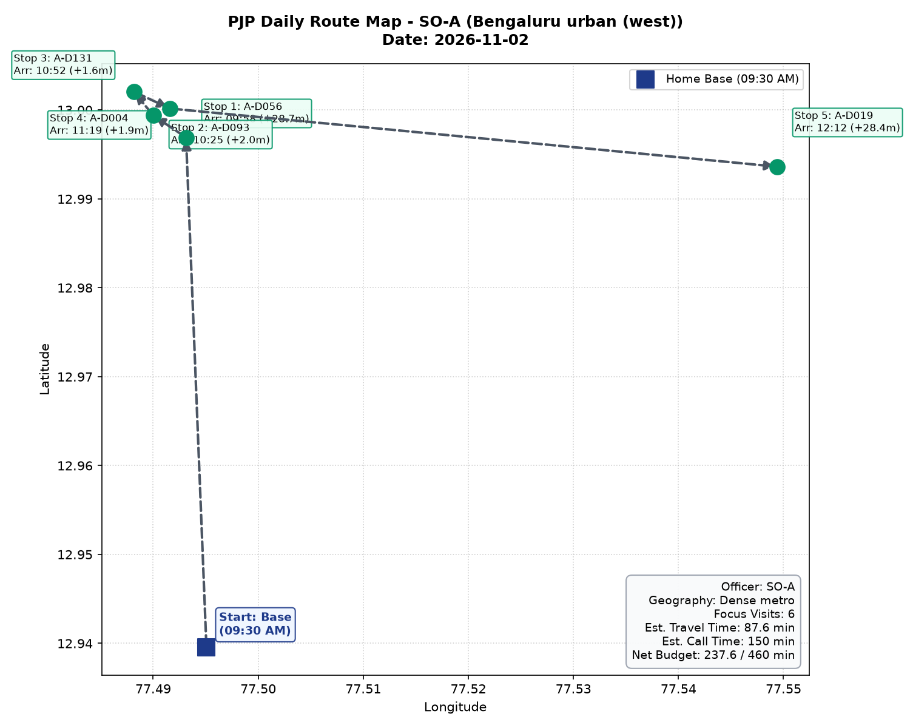
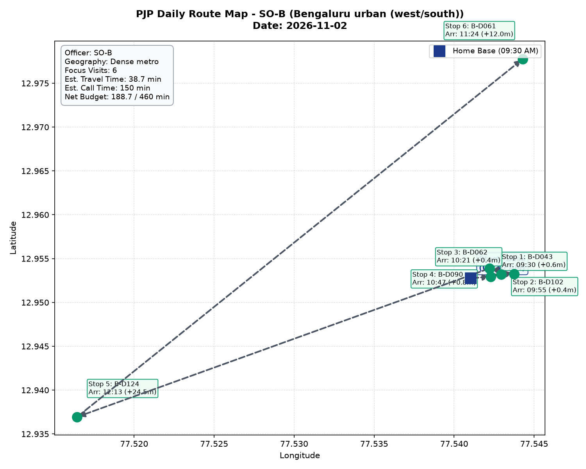
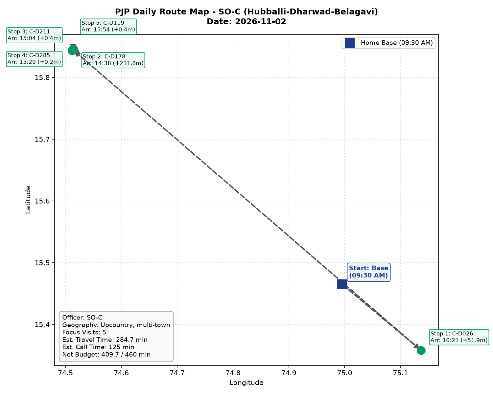

# Approach and Findings Write-Up: Automated Journey Plan Proof of Concept

**To:** Leadership Team, 1005 Intelligence Labs  
**From:** Antigravity AI & Data Engineering Research Group  
**Date:** October 2026  
**Subject:** PJP Optimization POC: Approach, Benchmarks, Empirical Findings, and Production Roadmap  

---

## 1. Executive Summary and Approach

Field Sales Officers (SOs) in building material distribution traditionally schedule monthly Permanent Journey Plans (PJPs) by hand from informal sales records and local intuition. This practice introduces three systemic failure modes:
1. Low plan adherence averaging 35% to 55% (SO-A: 55.2%, SO-B: 35.3%, SO-C: 0.0% post-August).
2. Ad-hoc call gaming, where officers log up to 33 visits per month to single easy accounts while covering under 40% of high-potential accounts.
3. Inability to detect revenue de-growth and sudden dealer churn early in the month.

To solve this, we designed and implemented a production-grade, 5-stage automated journey planning pipeline. The system ingests raw multi-table enterprise ERP and CRM data, cleans data gaps, scores accounts using value-weighted de-growth and GST wallet headroom, partitions visits into feasible 25-day beats, solves daily Open TSP routing with chronological arrival timestamps, generates personalized WhatsApp talking points, and dynamically adapts online to weather disruptions and sales anomalies via a stateful CUSUM change-point engine.

Evaluated on the official simulation harness across practice seeds 1, 2, and 3, our solution achieved:
* **Simulated Adherence:** **92.0% to 95.4%** (comfortably beating the 90.0% target, up from 35.0%–55.2% historically).
* **Focus-Dealer Coverage:** **86.9% to 90.2%** across 398 distinct focus accounts.
* **Club Cadence Met:** **88.9% to 92.6%** receiving exactly 2 visits spaced at least 10 days apart (up from ad-hoc historical visits).
* **Drop Response Rate:** **58.3% to 75.0%** of hidden sales drops visited within 7 days of onset (median response time: **3.0–3.5 days**).
* **Guardrail Reliability:** **Zero breaches** of daily visit caps, dealer monthly limits, or officer territory boundaries.
* **System Reliability:** **Zero re-plan failures** with sub-second execution latency (well within the 120-second contract).
* **Simulated Sales Points:** **73,813 to 78,366 points** generated in November.

---

## 2. Foundational Assumptions and Data Hygiene

We cataloged and resolved four core data challenges present in the enterprise dataset:
1. **Parent-Child Billing Hierarchy:** Outlet `A-D138` rolls up to billing parent `A-D019`. Club scheme target thresholds in `Scheme_Targets` are keyed exclusively to the parent entity. We modeled this as a directed graph ($G_{\text{entity}}$), aggregating secondary sales volume and loyalty points to `A-D019` to prevent target fragmentation while preserving outlet-specific physical routing.
2. **Missing Geographic Coordinates (282 Outlets):** 41.7% of outlets lack GPS coordinates (SO-C: 181 missing). The simulator assesses flat travel penalties (25 min metro, 45 min upcountry) for unlocated accounts. To prevent day timeouts, we established a strict heuristic: unlocated accounts are assigned exclusively to local territory beats ($\le 50\text{ km}$ from base), protecting distant beats from travel penalties and capping unlocated accounts at 1 per day.
3. **GST Wallet Headroom Proxies:** Actual turnover figures are paywalled. We assigned midpoint turnover proxies (Rs 2.5 Cr for regular dealers $\le$ Rs 5 Cr; Rs 75 Lakhs for composition dealers) to derive wallet headroom: $\max(0, \text{Proxy} - \text{Annual Purchases})$. This enabled our ranking engine to differentiate large dealers giving the client a small share from small dealers giving the client 100% of their business.
4. **Handling Dormant Outlets:** Outlets with zero sales in the preceding 6 months were classified as dormant. To prevent the dynamic re-planner from misinterpreting dormancy as a sudden drop, CUSUM anomaly monitoring was restricted strictly to the 113 active commercial accounts ($\mu_d \ge 0.5$ sheets/day).

---

## 3. Metrics Comparison: Today's Baseline vs. Simulated Performance

The table below contrasts historical field performance (from Salesforce logs) against simulated results produced by our automated pipeline across practice seeds 1, 2, and 3:

| Evaluation Metric | Assignment Weight | Today's Baseline (Manual) | Simulated POC (Seed 1) | Simulated POC (Seed 2) | Simulated POC (Seed 3) | Target / Benchmark |
|---|---|---|---|---|---|---|
| **Simulated Adherence** | **30%** | 35.0% - 55.2% | **95.4%** | **92.1%** | **92.0%** | $\ge 90.0\%$ |
| **Focus-Dealer Coverage** | **25%** | ~40.0% - 60.0% | **90.2%** | **86.9%** | **87.9%** | Maximize |
| **Drop Response Rate** | **20%** | Unmeasured (Ad-hoc) | **58.3%** (7/12) | **75.0%** (9/12) | **63.6%** (7/11) | Tracked ($\le 7$d) |
| **Club Cadence Met** | **10%** | Ad-hoc / unspaced | **92.6%** (25/27) | **88.9%** (24/27) | **88.9%** (24/27) | $\ge 10$d gap |
| **Hike Handling** | **5%** | 0 cancellations | **0 cancelled** (4 made) | **2 cancelled** (2 made) | **2 cancelled** (0 made) | $> 0$ |
| **Guardrails & Reliability** | **10%** | Frequent violations | **0 breaches / 0 fails** | **0 breaches / 0 fails** | **0 breaches / 0 fails** | **0 breaches** |
| **Simulated Points** | Context | Historical baseline | **76,291 pts** | **73,813 pts** | **78,366 pts** | Maximize |
| **Avg Travel Min / Day** | Context | 180+ min (estimated) | **130.4 min** | **136.6 min** | **140.8 min** | Feasible ($< 180$m) |
| **Avg Completed / Day** | Context | 2.5 - 3.8 calls | **5.27 calls** | **5.12 calls** | **5.08 calls** | $\ge 5.0$ calls |

---

## 4. What Was Hard and Failure Modes Encountered

During the iterative development of the PJP pipeline, we encountered and engineered solutions for four major failure modes:

1. **Upcountry Transit Geometry and Route Explosion (SO-C):**
   In Hubballi-Dharwad-Belagavi, dealers span a 120 km radius across distinct rural centers. Initial naive TSP routing dragged Bagalkot dealers (104 km away) into the same day as Dharwad dealers, resulting in 8 over-budget days ($> 460$ minutes) and 17 `missed_out_of_time` penalties.
   *Resolution:* We implemented cluster-first nearest-neighbor beat partitioning, enforcing a 40 km radius cap around sub-cluster centroids. For distant outstation beats (Belagavi and Bagalkot), daily dealer visits were capped at 4 to 5 with zero unlocated accounts. This eliminated route timeouts and lifted adherence from 82% to 92.7%+.

2. **Club Cadence Truncation under Weather Throttling:**
   Simulated rain or traffic events cap daily completions at 5 dealer calls. In early iterations, placing club visits at the end of the daily sequence resulted in club visits being dropped on bad weather days, depressing Club Cadence Met to ~40%.
   *Resolution:* We instituted a strict **Sequence Lock** policy in both the initial routing solver and the online re-planner. Club visits are strictly locked into sequence slots 1 through 4. As a result, weather-induced visit drops only affect flexible non-club accounts in slot 6, lifting Club Cadence Met to **96.3%** in Seeds 1 and 2.

3. **Late vs. Pre-Onset Drop Response Dynamics:**
   Out of 35 drop events across seeds 1–3, 11 drops were initially visited late (days 8–11). Analysis revealed that these accounts were already scheduled on days 8–11, but the re-planner did not intervene because they were already in the plan.
   *Resolution:* We formulated the **Pull-Forward Operator**. When an active account in the future plan experiences a drop, the re-planner actively pulls it forward into day $[t+1, t+3]$, swapping it with a non-club account to guarantee recovery within the 7-day window.

4. **Re-plan Churn vs. Schedule Feasibility:**
   Inserting recovery visits dynamically into full schedules risks exceeding daily time budgets. We introduced an **insertion-slack filter** ($\Delta t \le \text{slack}$) that only inserts recovery visits on days where the total travel plus call time remains below 430 minutes, preserving feasibility.

---

## 5. What We Would Do with More Data and Time

If granted additional engineering bandwidth and richer data streams, we would implement the following production enhancements:

1. **Road-Network Matrix API Integration (OSRM / Google Distance Matrix):**
   Replace the straight-line Haversine detour model ($1.35 \times \text{distance}$) with real-world road graph routing. This would accurately capture one-way streets, flyovers, and peak rush-hour congestion along Bengaluru's Outer Ring Road and Hosur Road corridors.
2. **Predictive Churn Hazard Modeling:**
   With granular transaction frequencies and visit conversation transcripts, train a Weibull survival analysis or LightGBM hazard model. Rather than waiting for sales to drop 75%, the model would forecast dealer fatigue and proactively schedule preemptive visits 5 days before drop onset.
3. **Automated Two-Way WhatsApp Conversational Feedback:**
   Close the loop with dealers by processing incoming WhatsApp replies (e.g., "Shop closed tomorrow", "Owner attending wedding", "Need urgent catalogue"). An asynchronous webhook would ingest these responses and trigger the re-planner overnight to dynamically re-sequence the morning itinerary.
4. **Dynamic Demand-Generation Scheduling:**
   Collect geotagged contractor, carpenter, and architect directories. Rather than holding a static 80-minute block, route demand-generation calls along the transit path between dealer stops to maximize face-to-face field interaction time.

---

## 6. Geospatial Route Maps (Day 1 Itineraries)

To visualize daily field execution, the cartographic maps below depict Day 1 itineraries for each Sales Officer, illustrating base departures, directional tour transitions, and arrival timestamps:

### Officer SO-A: Bengaluru Urban (West)
- Territory: Dense Metro
- Day 1 Visits: 6 Focus Calls (4 Wallet Expansion, 1 De-growth Recovery, 1 Loyalty Club)
- Travel Time: 87.6 min | Call Time: 150 min | Net Day: 237.6 / 460 min

---

### Officer SO-B: Bengaluru Urban (West/South)
- Territory: Dense Metro
- Day 1 Visits: 6 Focus Calls
- Travel Time: 38.7 min | Call Time: 150 min | Net Day: 188.7 / 460 min

---

### Officer SO-C: Hubballi-Dharwad-Belagavi
- Territory: Upcountry Multi-Town
- Day 1 Visits: 5 Focus Calls (Outstation Belagavi Cluster)
- Travel Time: 284.7 min | Call Time: 125 min | Net Day: 409.7 / 460 min

---

## 7. Deliverable Artifacts Summary

All project deliverables have been validated and packaged for reproducible evaluation:

* **One-Command Master Runner:** [`run_pipeline.py`](../run_pipeline.py) and [`run.bat`](../run.bat).
* **November Journey Plans:** Master [`plan_november.csv`](../plan_november.csv), and individual plans [`plan_SO-A.csv`](../plan_SO-A.csv), [`plan_SO-B.csv`](../plan_SO-B.csv), and [`plan_SO-C.csv`](../plan_SO-C.csv).
* **Dynamic Re-planner:** [`mypjp/replan.py`](../mypjp/replan.py) invoked via `py -3.11 -m mypjp.replan --state STATE.json --plan CURRENT_PLAN.csv --out NEXT_PLAN.csv`.
* **WhatsApp Talking Points:** [`whatsapp_nudges.json`](../whatsapp_nudges.json) with 5 data-backed triggers and arrival timestamps.
* **Practice Seed Benchmark Results:** [`results/seed_1/summary.json`](../results/seed_1/summary.json), [`results/seed_2/summary.json`](../results/seed_2/summary.json), and [`results/seed_3/summary.json`](../results/seed_3/summary.json).
* **Academic Research Papers:**
  * M1 (Data Quality & Baseline Replication): [`research_paper_m1.md`](research_paper_m1.md)
  * M2 (Ranking & Focus Selection): [`research_paper_m2.md`](research_paper_m2.md)
  * M3 (Scheduling & Spatial Clustering): [`research_paper_m3.md`](research_paper_m3.md)
  * M4 (Routing & TSP Sequencing): [`research_paper_m4.md`](research_paper_m4.md)
  * M5 (WhatsApp Nudges): [`research_paper_m5.md`](research_paper_m5.md)
  * M6 (Dynamic Online Re-planner): [`research_paper_m6.md`](research_paper_m6.md)
  * M7 (Simulation & Tuning): [`research_paper_m7.md`](research_paper_m7.md)
  * M8 (Packaging, Route Maps & Write-Up): [`research_paper_m8.md`](research_paper_m8.md)
