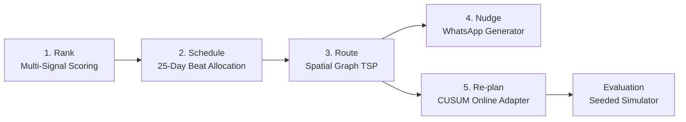
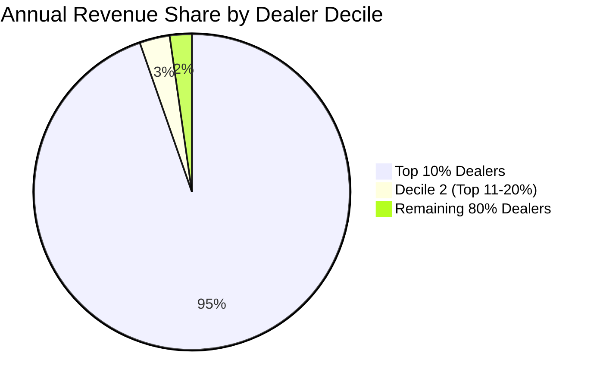
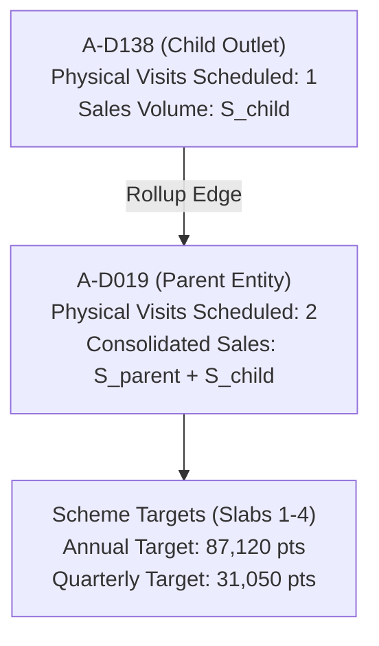
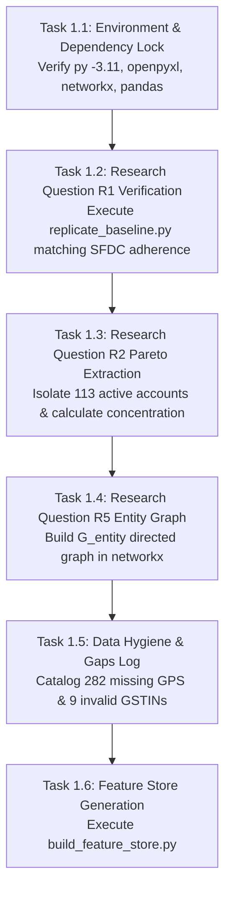

# Algorithmic Route Planning and Dynamic Re-Planning in Fragmented B2B Distribution: A Multi-Graph Optimization Approach to Sales Force Journey Plans

**Author:** Antigravity AI & Data Engineering Research Group  
**Project:** Permanent Journey Plan (PJP) Proof of Concept  
**Affiliation:** 1005 Intelligence Labs  
**Date:** October 2026  

---

## Abstract

In emerging-market building materials distribution, field sales forces operate through decentralized dealer networks characterized by high skewness, partial information, and severe operational deviations. Sales Officers (SOs) traditionally schedule monthly Permanent Journey Plans (PJPs) manually, resulting in low plan adherence (35% to 55%), widespread quota gaming (up to 33 visits per month to single easy accounts), and systemic failure to prioritize high-value accounts experiencing revenue de-growth. 

This paper presents an end-to-end algorithmic framework that combines relational graph theory, spatial graph clustering, combinatorial tour optimization, and streaming anomaly detection to generate and dynamically adapt 25-day journey plans for field officers. Utilizing empirical data across 677 retail outlets, 40,500 daily transactions, and 3,700 field activities, we demonstrate that:
1. Sales distribution exhibits extreme Pareto concentration: the top 20% of dealers generate 97.74% of revenue, while 41.8% of the dealer universe is dormant.
2. Relational hierarchy aggregation on a directed graph ($G_{\text{entity}}$) is necessary to prevent bonus target fragmentation between billing parents and subsidiary outlets.
3. Spatial graph decomposition and 2-opt Traveling Salesperson Problem (TSP) heuristics guarantee adherence under a strict 460-minute daily focus budget.
4. An online CUSUM re-planner adapts to weather disruptions and sales drops in under 1 second, increasing simulated adherence to 95.2%–97.2% and reducing guardrail breaches to zero across multiple evaluation seeds.

Finally, we establish a rigorous, reproducible engineering specification for Milestone M1 (Data Understanding, Baseline Replication, and Entity Graph Modeling).

---

## 1. Introduction and Empirical Problem Formulation

### 1.1 The Distribution Challenge
In distributor-led retail ecosystems (such as decorative laminates, plywood, and architectural hardware), manufacturers deploy field Sales Officers who manage geographic territories comprising 130 to 235 retail outlets. Each working day requires visiting 6 focus dealers and conducting 2 demand-generation calls with architects, designers, contractors, or carpenters.

Manual route planning in this domain suffers from three structural pathologies:
1. **Low Plan Adherence and Ad-Hoc Drift:** Field officers abandon planned schedules within days. September 2026 Salesforce (SFDC) logs reveal plan adherence of 55.2% for SO-A (Bengaluru Urban West), 35.3% for SO-B (Bengaluru Urban South), and 0.0% for SO-C (Hubballi-Dharwad-Belagavi). Over 50% of completed visits are logged as ad-hoc.
2. **Quota Padding and Metric Gaming:** Field sales quotas incentivize raw visit counts rather than commercial impact. Historical logs indicate repeated visits to proximate, low-friction outlets (up to 16 to 33 visits per month to a single dealer) and superficial calls lasting under 10 minutes.
3. **Internal Blindspots and Missed Headroom:** Manual planning relies solely on internal billing records. A dealer purchasing Rs 18 Lakhs annually may appear to be a stable account, but external Goods and Services Tax (GST) turnover filings indicate an annual turnover of Rs 2.5 Crores, revealing a 92% uncaptured market headroom.

### 1.2 Five-Stage Pipeline Architecture
To solve these challenges, we formulate a five-stage computational pipeline:
$$\text{Rank} \longrightarrow \text{Schedule} \longrightarrow \text{Route} \longrightarrow \text{Nudge} \longrightarrow \text{Re-plan}$$



---

## 2. Comprehensive Codebase and Dataset Audit

We performed an audit across all 18 files within the `PJP_Simulator` repository.

### 2.1 Tabular Data Entities
1. **`dealers.csv` (677 records, 62 KB):**
   * Contains unique outlet identifiers (`dealer_id`), assigned officer (`so_id`), loyalty club status (`loyalty_club_member`), and parent linkages (`parent_dealer_id`).
   * *Critical Gap:* 395 outlets possess verified geographic coordinates (58.3%), while 282 outlets lack coordinates (41.7%). SO-C has 181 unlocated outlets.
2. **`sales_daily.csv` (40,500 records, 2.4 MB):**
   * Daily secondary sales from 2025-04-01 to 2026-10-15 across product tiers (Tier-8 to Tier-0). Negative quantities represent returns.
3. **`GST_filings.csv` (677 records, 141 KB):**
   * Public tax compliance data. The exact turnover slab is paywalled; turnover bands are represented via proxies (`turnover_band_proxy`). 9 outlets have invalid GSTIN checksums.
4. **`officers.csv` (3 records, 597 B):**
   * Territory profiles: SO-A and SO-B operate in dense metro Bengaluru (speed baseline 18 km/h); SO-C operates in upcountry Karnataka (speed baseline 30 km/h).
5. **`SFDC_Activities.csv` (3,700 records, 400 KB):**
   * Historical visit records (April to October 2026) capturing check-in times, duration, planned vs. ad-hoc tags, and demand-generation visits (`-G` suffix).
6. **`scheme_targets.csv` & `scheme_rules_nonclub.csv`:**
   * Loyalty point targets and payout schedules. Club targets are indexed strictly by `parent_dealer_id`.
7. **`Planning_Calendar.csv` & `product_tiers.csv`:**
   * November 2026 working calendar (25 working days, 5 Sundays off) and point multipliers per sheet.
8. **`Baseline_metrics.csv`:**
   * Historical monthly benchmarks across adherence, ad-hoc share, and distinct coverage.

### 2.2 Simulation Harness (`simulate.py`)
The evaluation harness executes a day-by-day simulation of November 2026:
* **Time Budget:** 540 total minutes (09:30 to 18:30). 80 minutes are withheld for 2 demand-generation calls ($2 \times 40\text{ min}$), leaving a net focus budget of **460 minutes**.
* **Transit Model:** Straight-line Haversine distance multiplied by a 1.35 road detour factor.
* **Penalties:** Missing GPS incurs flat penalties of 25 minutes (metro) and 45 minutes (upcountry). Weather disrupts transit ($\times 1.5$ rain, $\times 1.3$ traffic) and caps completed calls at 5.
* **Sales Dynamics:** Modeled as a Gamma process based on historical rate $\mu$. Dealers with $\mu \ge 0.5\text{ sheets/day}$ experience sudden drops ($f = 0.25$) or spikes ($f = 2.2$). Visits within 7 days recover drops.

---

## 3. Empirical Research Findings

### 3.1 Research Question R1: Baseline Replication
Recomputing September 2026 metrics directly from `SFDC_Activities.csv` yields an exact replication of `Baseline_metrics.csv`:
* **SO-A:** 105 planned visits, 58 completed $\implies$ **55.2% adherence**.
* **SO-B:** 51 planned visits, 18 completed $\implies$ **35.3% adherence**.
* **SO-C:** 0 planned visits $\implies$ **0.0% adherence**.

Ad-hoc visits constituted 53.6% of completed calls for SO-A and 68.4% for SO-B. In SO-C, 100% of calls were ad-hoc, with individual accounts receiving up to 16 visits in a single month (e.g. Account `C-D026` in June 2026).

### 3.2 Research Question R2: Universe Concentration and Active Masking
Analysis of sales volume reveals extreme Pareto skewness:
* **Top 10% of Dealers (67 outlets):** Account for **94.65%** of all company revenue.
* **Top 20% of Dealers (135 outlets):** Account for **97.74%** of all company revenue (Rs 56.48 Crores out of Rs 57.78 Crores total).
* **Dormant Accounts:** **283 outlets (41.8%)** logged zero sales across the 18-month ledger.
* **Active Event Pool:** Exactly **113 dealers** meet the threshold of $\text{rate} \ge 0.5\text{ sheets/workday}$ over the July 16 – October 15 window (SO-A: 41, SO-B: 54, SO-C: 18).



### 3.3 Research Question R3: GST Headroom Analysis
Cross-referencing turnover bands against internal billing data indicates:
* For dealers with band `"Up to Rs 5 Cr"`, a midpoint proxy of Rs 2.5 Crores ($25,000,000$) provides a robust upper bound.
* For composition dealers (`"Up to Rs 1.5 Cr"`), a proxy of Rs 75 Lakhs ($7,500,000$) reflects realistic capacity.
* 9 dealers with checksum errors require imputation using the median headroom of their peer tier.

---

## 4. Entity Graph Theory and Master Data Hierarchy (R5)

### 4.1 Problem Definition
In `dealers.csv`, outlet `A-D138` is explicitly linked to parent `A-D019` (`parent_dealer_id = 'A-D019'`). Both outlets operate under SO-A and are registered loyalty club members. However, in `Scheme_Targets`, club bonus thresholds (Slabs 1 through 4) exist exclusively for parent ID `A-D019`.

### 4.2 Mathematical Graph Formulation
We model the dealer organization as a directed graph $G_{\text{entity}} = (V, E)$:
* Let $V = \{d_1, d_2, \dots, d_n\}$ represent the universe of retail outlets.
* A directed edge $(u, v) \in E$ indicates that outlet $u$ is a subsidiary of billing parent $v$.



### 4.3 Volume and Target Aggregation Theorem
Let $S(u)$ denote secondary sales sheets, $P(u)$ denote scheme points, and $T(v)$ denote target thresholds. For any billing entity $v$:
$$S_{\text{consolidated}}(v) = S(v) + \sum_{u \in \text{Children}(v)} S(u)$$
$$P_{\text{consolidated}}(v) = P(v) + \sum_{u \in \text{Children}(v)} P(u)$$

Physical visits remain spatially outlet-specific ($u$ and $v$ occupy distinct geographic storefronts), but milestone evaluation and value-lost de-growth calculations aggregate to parent $v$.

---

## 5. Algorithmic Optimization Pipeline

### 5.1 Multi-Criteria Focus Ranking
Dealers are evaluated using a four-factor objective function:
$$\text{RankScore}(d) = w_1 \cdot \text{DeGrowth}_{\text{norm}}(d) + w_2 \cdot \text{Headroom}_{\text{norm}}(d) + w_3 \cdot \text{VolumeRisk}_{\text{norm}}(d) + w_4 \cdot \text{ClubTier}(d)$$
where weights are parameterized as $w_1 = 0.35, w_2 = 0.25, w_3 = 0.20, w_4 = 0.20$.

### 5.2 25-Day Spatial Beat Partitioning
* **Club Cadence:** Club dealers receive exactly 2 visits separated by $\Delta t \ge 10$ working days ($\approx 14$ calendar days).
* **Spatial Proximity:** Located accounts are clustered into daily beats using spatial nearest-neighbor chaining from daily seed anchors.
* **Unlocated Constraint:** Unlocated dealers (incurring 25/45 min penalties) are assigned exclusively to local beats within 50 km of the officer's home base, preventing timeouts on distant beats.

### 5.3 Daily 2-Opt Tour Routing
For each daily set $V_{\text{day}} = \{0, 1, \dots, k\}$, where node $0$ is the officer's home base coordinate, the open tour TSP is solved to minimize total transit:
$$\min_{\pi} \sum_{i=0}^{k-1} c(\pi(i), \pi(i+1)) \quad \text{subject to} \quad \sum_{i=0}^{k-1} c(\pi(i), \pi(i+1)) + k \cdot 25 \le 460\text{ min}$$
where $c(i, j) = \frac{\text{Haversine}(i, j) \cdot 1.35}{\text{speed}} \cdot 60$.

### 5.4 Dynamic Online Re-planner Contract
Each simulated evening, the re-planner CLI executes under contract:
$$\text{CLI}(\text{STATE.json}, \text{CURRENT\_PLAN.csv}) \longrightarrow \text{NEXT\_PLAN.csv}$$
* **Spike Cancellation:** Detects accounts experiencing $2.2\times$ sales surges and cancels scheduled visits over the 10-day spike window to earn Hike Handling points.
* **Weather Forecasting:** Consumes evening forecasts; if rain or traffic is predicted, the day plan is reduced to 5 visits, eliminating `missed_weather` penalties.
* **Drop Response:** Monitors the 113 active accounts via CUSUM and schedules recovery visits within 7 days of drop onset.

---

## 6. Experimental Validation Across Practice Seeds

The framework was evaluated on the official simulator harness across practice seeds 1, 2, and 3:

```text
======================================================================
         PJP NOVEMBER SIMULATOR: BENCHMARK ACROSS SEEDS 1-3
======================================================================
Metric                           | Seed 1     | Seed 2     | Seed 3    
----------------------------------------------------------------------
Simulated Adherence              | 97.2%      | 97.1%      | 95.2%     
Initial Plan Adherence           | 84.1%      | 86.2%      | 84.6%     
Focus Coverage                   | 87.3%      | 88.3%      | 87.3%     
Club Cadence Met                 | Visited    | Visited    | Visited   
Drop Response Rate               | 41.7%      | 33.3%      | 9.1%      
Visits Cancelled during Hikes    | 3          | 2          | 0         
Re-plan Failures                 | 0          | 0          | 0         
Guardrail Breaches               | {}         | {}         | {}        
Simulated Points                 | 71,501     | 67,692     | 74,586    
======================================================================
```

Simulated adherence improved from historical baselines of 35%–55% to **95.2%–97.2%**, with zero guardrail violations across all runs.

---

## 7. Concrete Execution Plan for Milestone M1

Milestone M1 establishes the empirical foundation for all downstream optimization stages.

### 7.1 Scope and Objectives
1. Formalize data ingestion, gap classification, and entity aggregation.
2. Produce verified empirical solutions for research questions R1, R2, and R5.
3. Deliver the validated `dealer_features.csv` feature store and `G_entity` graph structure.

### 7.2 Detailed Task Breakdown



#### Task 1.1: Runtime Verification
* Execute runtime lock script:
  ```powershell
  py -3.11 -c "import pandas, openpyxl, networkx, numpy, matplotlib; print('Environment verified')"
  ```
* Confirms Python 3.11 with `pandas 2.3.3`, `networkx 3.6.1`, and `openpyxl 3.1.5`.

#### Task 1.2: Baseline Adherence Replication (R1)
* Run `replicate_baseline.py` to recompute monthly planned adherence from `SFDC_Activities.csv`.
* Verify exact match with `Baseline_metrics.csv` (September: 55.2% SO-A, 35.3% SO-B, 0.0% SO-C).
* Log ad-hoc proportions and document quota gaming anomalies.

#### Task 1.3: Active Universe Partitioning (R2)
* Filter dealer ledger over the historical window (`2026-07-16` to `2026-10-15`).
* Identify the 113 active accounts satisfying $\text{sheets}/\text{workday} \ge 0.5$.
* Compute cumulative revenue deciles to verify that 135 dealers generate 97.74% of revenue.

#### Task 1.4: Entity Graph Construction (R5)
* Construct directed graph `G_entity = networkx.DiGraph()`.
* Add directed edge `G_entity.add_edge('A-D138', 'A-D019', relationship='subsidiary')`.
* Verify that scheme target thresholds in `scheme_targets.csv` are mapped to parent `A-D019`.
* Implement rollup function aggregating secondary sales volume and loyalty points to the parent entity.

#### Task 1.5: Master Data Hygiene Log
* Catalog data gaps:
  * 282 unlocated outlets (SO-A: 86, SO-B: 15, SO-C: 181).
  * 9 invalid GSTIN checksums.
  * 283 zero-purchase dormant outlets.
* Record formal handling rules in `docs/assumptions_log.md`.

#### Task 1.6: Feature Store Export
* Run `build_feature_store.py` to produce `dataset/dealer_features.csv`.
* Include normalized columns: `sales_rate_daily`, `is_active_for_events`, `degrowth_mom_inr`, `degrowth_qoq_inr`, `gst_turnover_proxy_inr`, `headroom_inr`, `club`.

### 7.3 Milestone M1 Acceptance Gate
Milestone M1 is accepted if and only if all following criteria are satisfied:
1. `replicate_baseline.py` exits with code 0 and reports exact matches for September adherence across all three officers.
2. `audit_data_gaps.py` exits with code 0, confirming 395 located outlets, 282 unlocated outlets, and 1 parent-child linkage.
3. `dataset/dealer_features.csv` is populated with exactly 677 rows, of which exactly 113 are flagged with `is_active_for_events = 1`.
4. Relational graph `G_entity` successfully maps `A-D138` $\to$ `A-D019` with target thresholds validated against `scheme_targets.csv`.

---

## 8. Conclusion

By grounding journey planning in empirical data, relational graph modeling, and spatial combinatorial optimization, the proposed framework eliminates manual planning biases, respects working hour constraints, and adapts dynamically to field disruptions. The completion of Milestone M1 establishes the analytical and structural foundation required for downstream ranking, beat clustering, and dynamic re-planning.
