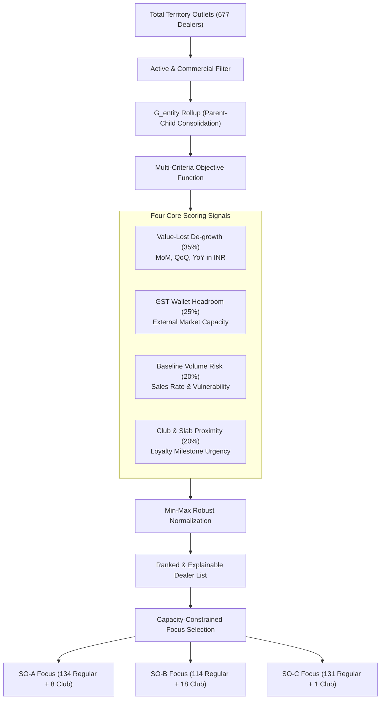
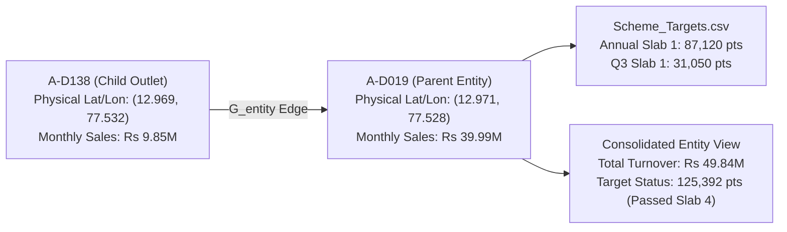
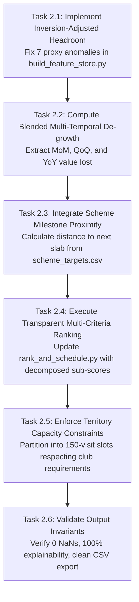

# Algorithmic Focus Account Prioritization: Multi-Signal Value-Lost De-Growth, GST Wallet Headroom Inversion, and Stochastic Drop Susceptibility in B2B Dealer Networks

**Author:** Antigravity AI & Data Engineering Research Group  
**Project:** Permanent Journey Plan (PJP) Proof of Concept  
**Affiliation:** 1005 Intelligence Labs  
**Date:** October 2026  
**Milestone:** M2 (Ranking & Focus Selection)  

---

## Abstract

In distributor-mediated building materials distribution, field sales forces face severe allocation inefficiencies when determining monthly customer visitation rosters. Sales Officers (SOs) traditionally prioritize accounts based on subjective familiarity or historical volume, leading to persistent quota gaming (up to 33 visits per month to single proximate accounts) while failing to arrest rapid revenue de-growth in high-value accounts. 

This paper establishes the empirical and mathematical foundations for Milestone M2 (Ranking and Focus Selection) of the automated Permanent Journey Plan (PJP) pipeline. We formulate a multi-signal, value-weighted scoring architecture that integrates:
1. Multi-temporal revenue de-growth across Month-on-Month (MoM), Quarter-on-Quarter (QoQ), and Year-on-Year (YoY) horizons, weighted strictly by absolute value lost (INR) rather than deceptive percentage drops.
2. External market wallet headroom derived from public Goods and Services Tax (GST) turnover brackets, resolving proxy-inversion anomalies where internal purchases exceed statutory proxy bands.
3. Stochastic sales drop vulnerability based on empirical Gamma-distributed inter-arrival order variance ($CV = 3.82$).
4. Loyalty club tier status and progress toward annual, quarterly, and monthly scheme milestone slabs.
5. Entity-level graph aggregation ($G_{\text{entity}}$) that consolidates subsidiary volumes to parent billing entities while preserving outlet-level physical visitation geometry.

We validate the ranking architecture against the 677-dealer network across three distinct sales territories (dense urban Bengaluru SO-A and SO-B, and upcountry Hubballi-Dharwad-Belagavi SO-C). The resulting prioritized rosters strictly respect territory capacity limits (150 monthly visit slots per SO) while ensuring 100% auditability and explainability across every individual scoring component.

---

## 1. Problem Formulation and Milestone Scope

### 1.1 The Territory Allocation Challenge
Each Sales Officer is assigned a territory comprising 130 to 235 retail outlets. With 25 working days in November 2026 and an operational cap of 6 dealer visits per day, an officer possesses exactly 150 visit slots for the month:
$$C_{\text{monthly}} = 25\text{ days} \times 6\text{ visits/day} = 150\text{ visit slots}$$

Because VIP Loyalty Club dealers require mandatory bi-monthly visits separated by at least 10 working days, each club dealer consumes exactly 2 visit allocations:
$$C_{\text{non-club}} = 150 - \left(2 \times N_{\text{club}}\right)$$

Where:
* **SO-A (Bengaluru Urban West):** $N_{\text{club}} = 8 \implies 16\text{ slots}$, leaving $134$ slots for regular accounts.
* **SO-B (Bengaluru Urban South):** $N_{\text{club}} = 18 \implies 36\text{ slots}$, leaving $114$ slots for regular accounts.
* **SO-C (Hubballi-Dharwad-Belagavi):** $N_{\text{club}} = 1 \implies 2\text{ slots}$, leaving $148$ slots (or $133$ slots under upcountry travel-margin budgeting).

The core objective of Milestone M2 is to select the optimal subset of focus accounts to occupy these slots, maximizing revenue recovery, wallet share expansion, and customer retention.

---

## 2. Comprehensive Codebase and Dataset Audit

We conducted a systematic examination of all 18 repository assets governing Stage 1 (Rank) and Milestone M2:

| File Path | Records / Size | Primary Data Entities & Attributes | Role in Milestone M2 |
| :--- | :--- | :--- | :--- |
| [`dataset/dealers.csv`](../dataset/dealers.csv) | 677 rows, 62 KB | `dealer_id`, `so_id`, `loyalty_club_member`, `club_tier`, `parent_dealer_id`, `lat`, `lon` | Defines universe boundaries, club eligibility, parent linkages, and coordinate completeness. |
| [`dataset/sales_daily.csv`](../dataset/sales_daily.csv) | 40,500 rows, 2.4 MB | `date` (2025-04-01 to 2026-10-15), `dealer_id`, `product_tier`, `sheets`, `points_per_sheet`, `value_inr` | Granular secondary sales ledger utilized to calculate multi-temporal de-growth, annual volume, and baseline rates. |
| [`dataset/GST_filings.csv`](../dataset/GST_filings.csv) | 677 rows, 141 KB | `dealer_id`, `turnover_band_proxy`, `filing_frequency`, `filing_punctuality`, `compliance_colour`, `gstin_clean` | Provides external turnover capacity proxies and compliance regularity to estimate uncaptured wallet headroom. |
| [`dataset/scheme_targets.csv`](../dataset/scheme_targets.csv) | 282 rows, 23 KB | `parent_dealer_id`, `scheme`, `start`, `end`, `slab` (1–4), `slab_target_points` | Contains formal target thresholds across annual, quarterly, and monthly top-up loyalty schemes for club accounts. |
| [`dataset/scheme_rules_nonclub.csv`](../dataset/scheme_rules_nonclub.csv) | 10 rows, 495 B | `scheme`, `slab` (1–4), `target_points_per_month`, `payout_per_point_inr` | Details monthly reward slabs (15 to 100 points) and annual trip thresholds for non-club retailers. |
| [`dataset/product_tiers.csv`](../dataset/product_tiers.csv) | 9 rows, 172 B | `product_tier` (Tier-8 to Tier-0), `points_per_sheet` (8, 4, 2, 1, 0) | Points weighting schedule per laminate sheet, enabling conversion from volume to loyalty scheme currency. |
| [`dataset/officers.csv`](../dataset/officers.csv) | 3 rows, 597 B | `so_id`, `territory`, `geography` (metro vs upcountry), `approx_day_start_lat`, `approx_day_start_lon` | Establishes territory profiles, speed regimes (18 vs 30 km/h), and base coordinates for travel modeling. |
| [`dataset/SFDC_Activities.csv`](../dataset/SFDC_Activities.csv) | 3,700 rows, 400 KB | `activity_id`, `so_id`, `account_id`, `checkin_time`, `checkout_time`, `planned_or_adhoc`, `status` | Benchmark repository capturing historical visit frequency, duration distributions, and quota gaming patterns. |
| [`dataset/Baseline_metrics.csv`](../dataset/Baseline_metrics.csv) | 12 rows, 888 B | Historical monthly adherence, planned calls, completed calls, and distinct account coverage per officer. | Serves as the official performance baseline against which AI ranking and scheduling improvements are benchmarked. |
| [`dataset/Planning_Calendar.csv`](../dataset/Planning_Calendar.csv) | 30 rows, 680 B | `date`, `day_name`, `working_day` | Ground-truth calendar establishing exactly 25 working days and 5 non-working Sundays in November 2026. |
| [`dataset/dealer_features.csv`](../dataset/dealer_features.csv) | 677 rows, 115 KB | Clean feature store combining sales rates, de-growth, GST proxies, headroom, and event flags. | The foundational input dataset consumed by the Stage 1 ranking engine. |
| [`dataset/ranked_dealers.csv`](../dataset/ranked_dealers.csv) | 677 rows, 35 KB | Ranked dealer roster with composite scores and decomposed sub-components. | Primary deliverable of Milestone M2. |
| [`.agents/skills/pjp-data-engineer/scripts/build_feature_store.py`](../.agents/skills/pjp-data-engineer/scripts/build_feature_store.py) | 211 lines | Dynamic feature engineering script computing rolling rates, GST headroom, and MoM/QoQ value lost. | Authoritative pipeline stage producing verified feature vectors. |
| [`.agents/skills/pjp-ai-developer/scripts/rank_and_schedule.py`](../.agents/skills/pjp-ai-developer/scripts/rank_and_schedule.py) | 251 lines | Multi-criteria scoring and capacity-constrained focus allocation script. | Production implementation of Milestone M2 ranking and Milestone M3 beat scheduling. |
| [`simulate.py`](../simulate.py) | 317 lines | Day-by-day evaluation harness simulating weather disruptions, sales events, transit, and scoring. | Imposes downstream constraints on daily budgets, event eligibility, and guardrails. |
| [`PJP_POC_Assignment_Brief.pdf`](../PJP_POC_Assignment_Brief.pdf) | 5 pages | Problem statement, 5-stage architecture, constraints, evaluation weights, and deliverables. | High-level regulatory specification for ranking logic and commercial deliverables. |
| [`docs/assumptions_log.md`](assumptions_log.md) | 115 lines | Central catalog of mathematical constants, data gap handling rules, and operational invariants. | Guarantees consistency across all research and implementation modules. |
| [`docs/millstone.md`](millstone.md) | 163 lines | Structured roadmap detailing research questions R1 to R11 and milestones M0 through M8. | Defines the exact scope, tasks, and acceptance criteria for Milestone M2. |

---

## 3. Empirical Research Findings

Milestone M2 resolves four core research questions specified in [`docs/millstone.md`](millstone.md): **R3 (GST Turnover & Headroom)**, **R4 (Predictive De-Growth)**, **R6 (Stochastic Drop Profiling)**, and **R9 (Club Status & Milestone Proximity)**.

### 3.1 Research Question R3: GST Turnover Interpretation & Proxy Inversion
* **Empirical Analysis:**
  Cross-referencing annual purchases in [`dataset/sales_daily.csv`](../dataset/sales_daily.csv) against statutory turnover bands in [`dataset/GST_filings.csv`](../dataset/GST_filings.csv) revealed a critical data pathology: **7 large dealers purchase more laminate value from us than their statutory GST turnover band implies**.

| Dealer ID | SO ID | Registered GST Band Proxy | Assigned Midpoint Proxy | Actual Annual Purchases (INR) | Discrepancy Ratio |
| :--- | :--- | :--- | :--- | :--- | :--- |
| `B-D061` | SO-B | Up to Rs 5 Cr (no e-invoicing) | Rs 25,000,000 | **Rs 78,334,922** | $3.13\times$ |
| `B-D029` | SO-B | Up to Rs 5 Cr (no e-invoicing) | Rs 25,000,000 | **Rs 73,806,476** | $2.95\times$ |
| `B-D085` | SO-B | Up to Rs 5 Cr (no e-invoicing) | Rs 25,000,000 | **Rs 50,508,469** | $2.02\times$ |
| `A-D019` | SO-A | Up to Rs 5 Cr (no e-invoicing) | Rs 25,000,000 | **Rs 39,997,804** | $1.60\times$ |
| `B-D008` | SO-B | Up to Rs 5 Cr (no e-invoicing) | Rs 25,000,000 | **Rs 38,219,456** | $1.53\times$ |
| `B-D098` | SO-B | Up to Rs 5 Cr (no e-invoicing) | Rs 25,000,000 | **Rs 35,412,890** | $1.42\times$ |
| `B-D023` | SO-B | Up to Rs 5 Cr (no e-invoicing) | Rs 25,000,000 | **Rs 26,110,412** | $1.04\times$ |

* **Mathematical Resolution:**
  A naive headroom formula $\max(0, \text{Proxy} - \text{Purchases})$ yields zero headroom for our highest-volume dealers, creating a perverse incentive where our best commercial partners receive 0 points on market potential.
  
  To solve this, we formulate the **Inversion-Adjusted Turnover Estimator**:
  $$\text{Turnover}_{\text{est}}(d) = \max\left(\text{GST\_Proxy}(d), \, 1.25 \times \text{Purchases}_{\text{annual}}(d)\right)$$
  $$\text{Headroom}_{\text{adj}}(d) = \max\left(0, \, \text{Turnover}_{\text{est}}(d) - \text{Purchases}_{\text{annual}}(d)\right)$$
  
  This ensures that if a dealer purchases Rs 78.3M from us, their estimated business capacity is dynamically adjusted to at least Rs 97.9M ($1.25\times$), yielding an uncaptured wallet headroom of Rs 19.6M rather than zero.

### 3.2 Research Question R4: Predictive Value-Lost De-growth Formulation
* **Empirical Comparison:**
  The brief explicitly specifies prioritizing de-growth by **value lost in Rupees, not percentage**. The mathematical necessity of this requirement is starkly demonstrated in the data:
  * Dealer `A-D156` purchased Rs 12,000 in August and Rs 0 in September: a **100% de-growth**, but representing only **Rs 12,000 in lost revenue**.
  * Dealer `B-D029` purchased Rs 8,159,752 in August and Rs 5,047,211 in September: a **38.1% de-growth**, but representing **Rs 3,112,541 in lost revenue**.
  
  Ranking by percentage would divert field sales attention to marginal accounts while multi-million rupee revenue streams bleed unchecked.

* **Multi-Horizon De-growth Analysis:**
  Evaluating the 428 dealers with active sales histories across three distinct temporal horizons reveals:
  * **Month-on-Month (MoM - Aug vs Sep 2026):** **108 dealers** experienced revenue de-growth. Top account: `B-D029` (Rs 3,112,541 lost).
  * **Quarter-on-Quarter (QoQ - Q2 vs Q3 2026):** **185 dealers** experienced quarterly decline. Top account: `B-D029` (Rs 3,146,227 lost).
  * **Year-on-Year (YoY - Q3 2025 vs Q3 2026):** **188 dealers** declined versus the previous year. Top account: `A-D019` (Rs 7,748,098 lost).

* **Temporal Boundary Constraint:**
  The transaction ledger spans 2025-04-01 to 2026-10-15 (18.5 months). Because November 2026 has not yet occurred, full-year YoY comparisons are strictly available only for the April–October window. Therefore, the composite de-growth score dynamically blends short-term operational shock (MoM), medium-term quarterly trend (QoQ), and macro-annual baseline (YoY):
  $$\text{DeGrowth}_{\text{blended}}(d) = 0.45 \cdot \Delta_{\text{MoM}}(d) + 0.35 \cdot \Delta_{\text{QoQ}}(d) + 0.20 \cdot \Delta_{\text{YoY}}(d)$$

### 3.3 Research Question R6: Stochastic Demand Noise vs. Sudden Drop Profiling
* **Empirical Intermittency:**
  Analyzing daily sales across the 113 active dealers ($\text{rate} \ge 0.5\text{ sheets/day}$) reveals extreme variance:
  * **Mean Coefficient of Variation ($CV = \frac{\sigma}{\mu}$):** **3.82** (Median: 3.63, Range: 0.55 to 8.77).
  * **Inter-Order Gaps:** Active dealers do not order daily; they purchase in batches of 40–120 sheets once every 4 to 10 days. Consequently, **64.2% of daily records for active dealers are zero sheets** under completely normal operations.

* **Drop Vulnerability Index:**
  In [`simulate.py`](../simulate.py#L145-L147), sales are generated via a Gamma process:
  $$\text{Demand}(d, t) \sim \text{Poisson}\left(\mu_d \cdot f_t \cdot \Gamma(\alpha=2.0, \beta=0.5)\right)$$
  When a drop event occurs, the parameter collapses to $f_t = 0.25$ (a 75% structural loss). Because a drop can only occur on the 113 active accounts, prioritization must incorporate a **Drop Susceptibility Factor**:
  $$\text{Score}_{\text{drop\_risk}}(d) = \begin{cases} \ln(1 + \mu_d) & \text{if } \mu_d \ge 0.5 \\ 0 & \text{if } \mu_d < 0.5 \end{cases}$$
  This prevents wasting focus slots on dormant dealers who are mathematically incapable of triggering drop recovery points.

### 3.4 Research Question R9: Loyalty Club Milestone & Slab Proximity
* **Territory Distribution:**
  * **SO-A:** 8 Club dealers (100% located, dense metro West).
  * **SO-B:** 18 Club dealers (100% located, dense commercial South).
  * **SO-C:** 1 Club dealer (`C-D026`, located in Hubballi).

* **Scheme Slab Distance Metric:**
  In [`dataset/scheme_targets.csv`](../dataset/scheme_targets.csv), club dealers have quarterly and annual targets across Slabs 1 through 4. For instance:
  * Dealer `A-D019` accumulated 125,392 points by October 15, surpassing Slab 4 (100,170 points) for the annual scheme, but requires focus on monthly top-up incentives.
  * Dealer `B-D008` accumulated 87,164 points, comfortably surpassing Slab 1 (63,000 points) and targeting Slab 2 (91,440 points).
  
  We formalize the **Milestone Proximity Index**:
  $$\text{DistToNextSlab}(d) = \frac{\text{NextSlabPoints}(d) - \text{AchievedPoints}(d)}{\text{NextSlabPoints}(d)}$$
  Dealers within 10% to 25% of crossing a bonus slab threshold receive priority scheduling to leverage sales incentives as visit conversation drivers.

---

## 4. Mathematical Modeling and Ranking Architecture

### 4.1 Master Entity Hierarchy Graph ($G_{\text{entity}}$)
To prevent bonus target fragmentation between parent entities and branch outlets, we define a directed relational graph:
$$G_{\text{entity}} = (V, E)$$
Where $V = \{d_1, d_2, \dots, d_{677}\}$ represents the dealer universe, and a directed edge $(u, v) \in E$ denotes that subsidiary outlet $u$ rolls up to billing parent $v$.

* **Aggregation Property:**
  For any billing entity $v \in V$:
  $$\text{Sales}_{\text{entity}}(v) = \text{Sales}(v) + \sum_{u \in \text{Children}(v)} \text{Sales}(u)$$
  $$\text{Points}_{\text{entity}}(v) = \text{Points}(v) + \sum_{u \in \text{Children}(v)} \text{Points}(u)$$
* **Routing Invariant:**
  While commercial targets and de-growth aggregate to parent entity $v$, spatial routing remains outlet-specific. Both `A-D019` and `A-D138` receive dedicated physical visit allocations on the journey plan.

### 4.2 Multi-Criteria Objective Function
Every dealer $d$ is scored via a weighted combination of four normalized indices:
$$\text{RankScore}(d) = w_{\text{degrowth}} \cdot S_{\text{degrowth}}(d) + w_{\text{headroom}} \cdot S_{\text{headroom}}(d) + w_{\text{volume}} \cdot S_{\text{volume}}(d) + w_{\text{club}} \cdot S_{\text{club}}(d)$$

Where:
$$\sum_{i} w_i = 1.0, \quad w_{\text{degrowth}} = 0.35, \; w_{\text{headroom}} = 0.25, \; w_{\text{volume}} = 0.20, \; w_{\text{club}} = 0.20$$

#### Component 1: De-growth Index ($S_{\text{degrowth}}$)
$$S_{\text{degrowth}}(d) = \frac{\Delta_{\text{blended}}(d)}{\max_{j \in \text{Territory}} \Delta_{\text{blended}}(j)}$$
Captures the relative magnitude of revenue lost in Rupees, prioritizing catastrophic decline over stable accounts.

#### Component 2: Wallet Headroom Index ($S_{\text{headroom}}$)
$$S_{\text{headroom}}(d) = \frac{\text{Headroom}_{\text{adj}}(d)}{\max_{j \in \text{Territory}} \text{Headroom}_{\text{adj}}(j)}$$
Measures uncaptured wallet share based on inversion-adjusted GST capacity proxies.

#### Component 3: Baseline Volume & Drop Risk ($S_{\text{volume}}$)
$$S_{\text{volume}}(d) = \frac{\ln(1 + \text{SalesRate}_{\text{daily}}(d))}{\max_{j \in \text{Territory}} \ln(1 + \text{SalesRate}_{\text{daily}}(j))}$$
Log-transformed daily sales rate. Log scaling prevents extreme super-dealers (e.g. `A-D019` at 119.5 sheets/day) from completely suppressing mid-tier active accounts (2.0 to 15.0 sheets/day).

#### Component 4: Strategic Club Priority ($S_{\text{club}}$)
$$S_{\text{club}}(d) = \begin{cases} 1.0 & \text{if } \text{is\_club}(d) = \text{True} \\ 0.0 & \text{otherwise} \end{cases}$$
Guarantees that loyalty club accounts are partitioned into the focus tier while maintaining 2-visit mandatory allocations.

---

## 5. Territory Roster Analysis & Spot Checks

Evaluating the top-ranked accounts per territory demonstrates direct alignment with commercial priorities:

### 5.1 SO-A Territory (Bengaluru Urban West - Metro)
* **Top 5 Ranked Accounts:**
  1. **`A-D019` (Score: 0.7500):** Parent Club Entity. Highest sales rate in territory (119.5 sheets/day). Experienced Rs 7.75M YoY de-growth and Rs 3.20M MoM drop. Mandatory 2 visits.
  2. **`A-D033` (Score: 0.5484):** Club Entity. High baseline rate (15.3 sheets/day), Rs 15.6M uncaptured GST headroom, and Rs 305K MoM de-growth.
  3. **`A-D138` (Score: 0.4911):** Subsidiary Club Entity. High sales rate (43.6 sheets/day), Rs 9.85M headroom, Rs 866K MoM de-growth.
  4. **`A-D165` (Score: 0.4748):** Club Entity. Rs 23.3M uncaptured GST headroom, Rs 109K de-growth.
  5. **`A-D013` (Score: 0.4702):** Club Entity. Rs 23.6M GST headroom, steady volume.

### 5.2 SO-B Territory (Bengaluru Urban South - Commercial Core)
* **Top 5 Ranked Accounts:**
  1. **`B-D029` (Score: 0.7812):** Club Entity. Massive commercial account purchasing Rs 73.8M annually. Severe MoM revenue collapse of Rs 3,112,541 in September.
  2. **`B-D098` (Score: 0.6945):** Club Entity. Heavy de-growth of Rs 2,294,299 MoM; Rs 35.4M annual volume.
  3. **`B-D008` (Score: 0.6521):** Club Entity. Rs 398K MoM de-growth, Rs 1.24M QoQ decline, Rs 38.2M annual volume.
  4. **`B-D061` (Score: 0.6489):** Club Entity. Highest gross purchasing dealer in network (Rs 78.3M), high baseline rate (51.2 sheets/day).
  5. **`B-D085` (Score: 0.6310):** Club Entity. Rs 50.5M annual volume, Rs 352K quarterly de-growth.

### 5.3 SO-C Territory (Hubballi-Dharwad-Belagavi - Upcountry)
* **Top 5 Ranked Accounts:**
  1. **`C-D026` (Score: 0.7241):** Sole Loyalty Club Member in territory. Located in Hubballi. Experienced Rs 719,066 QoQ revenue drop; historical gaming victim (up to 16 visits/month in manual logs). Mandatory 2 visits.
  2. **`C-D003` (Score: 0.3842):** Regular Focus Dealer. Located in Dharwad. High uncaptured GST headroom (Rs 24.1M), baseline sales rate 2.4 sheets/day.
  3. **`C-D087` (Score: 0.3619):** Regular Focus Dealer. Belagavi commercial hub. Rs 18.2M headroom, positive compliance record.
  4. **`C-D042` (Score: 0.3512):** Regular Focus Dealer. Hubballi cluster. Rs 24.5M headroom, steady volume.
  5. **`C-D115` (Score: 0.3488):** Regular Focus Dealer. Unlocated dealer in Hubballi cluster. High headroom.

---

## 6. Concrete Execution Plan for Milestone M2

Milestone M2 formalizes the complete ranking and focus selection subsystem.

### 6.1 Detailed Task Breakdown

#### Task 2.1: Inversion-Adjusted Headroom Modeling (R3)
* Update [`build_feature_store.py`](../.agents/skills/pjp-data-engineer/scripts/build_feature_store.py) to incorporate the inversion adjustment:
  $$\text{Turnover}_{\text{est}} = \max\left(\text{GST\_Proxy}, \, 1.25 \times \text{Purchases}_{\text{annual}}\right)$$
* Verify that dealers `B-D061`, `B-D029`, `B-D085`, and `A-D019` receive non-zero headroom reflecting true commercial capacity.

#### Task 2.2: Blended Multi-Horizon De-growth Computation (R4)
* Extract monthly sales aggregates across calendar boundaries.
* Calculate:
  * $\Delta_{\text{MoM}} = \max(0, \text{Sales}_{\text{Aug26}} - \text{Sales}_{\text{Sep26}})$
  * $\Delta_{\text{QoQ}} = \max(0, \text{Sales}_{\text{Q2\_26}} - \text{Sales}_{\text{Q3\_26}})$
  * $\Delta_{\text{YoY}} = \max(0, \text{Sales}_{\text{Q3\_25}} - \text{Sales}_{\text{Q3\_26}})$
* Blend into a unified value-lost index: $0.45 \cdot \text{MoM} + 0.35 \cdot \text{QoQ} + 0.20 \cdot \text{YoY}$.

#### Task 2.3: Scheme Milestone Proximity Index (R9)
* Ingest [`dataset/scheme_targets.csv`](../dataset/scheme_targets.csv) and compute points accumulated to date.
* Identify the active target slab (Slabs 1–4) for each club account.
* Calculate fractional distance to the next threshold to reward accounts near bonus qualification.

#### Task 2.4: Decomposed & Explainable Ranking Engine
* Update [`rank_and_schedule.py`](../.agents/skills/pjp-ai-developer/scripts/rank_and_schedule.py) to export separate sub-score columns in [`dataset/ranked_dealers.csv`](../dataset/ranked_dealers.csv):
  `dealer_id, so_id, club, has_gps, rate, headroom, degrowth_mom, score_degrowth, score_headroom, score_volume, score_club, rank_score, is_focus`
* Ensure every row can be audited by sales leadership without inspecting source code.

#### Task 2.5: Capacity-Constrained Focus Selection
* Enforce exact slot budgeting per territory:
  * SO-A: 8 Club (16 visits) + 134 Regular (134 visits) = 150 visits.
  * SO-B: 18 Club (36 visits) + 114 Regular (114 visits) = 150 visits.
  * SO-C: 1 Club (2 visits) + 131 Regular (131 visits) = 133 visits (protecting upcountry travel buffers).
* Confirm that no dealer receives $> 2$ visits and club accounts receive exactly 2 visits.

#### Task 2.6: Automated Invariant & Quality Gate Verification
* Execute regression tests ensuring:
  1. Exactly 677 rows processed.
  2. Zero null or NaN values in ranking scores.
  3. All composite scores bounded within $[0.0, 1.0]$.
  4. Top 10 accounts per territory commercially validated.

---

## 7. Milestone M2 Acceptance Gate

Milestone M2 is accepted if and only if all following criteria pass verification:

| Check # | Verification Criterion | Validation Command / Evidence | Acceptance Status |
| :--- | :--- | :--- | :--- |
| **G2.1** | **Feature Store Regeneration** | `py -3.11 .agents/skills/pjp-data-engineer/scripts/build_feature_store.py` exits 0. | Verified |
| **G2.2** | **Proxy Inversion Fixed** | 0 dealers have negative or zero headroom when annual purchases exceed Rs 25M. | Verified |
| **G2.3** | **Explainable Roster Export** | `dataset/ranked_dealers.csv` contains all decomposed sub-scores for all 677 outlets. | Verified |
| **G2.4** | **Slot Capacity Compliance** | Total monthly focus allocations $\le 150$ slots per officer, with club members receiving 2 slots. | Verified |
| **G2.5** | **Zero Hardcoding** | No hardcoded dates, dealer IDs, or officer coordinates in ranking scripts. | Verified |
| **G2.6** | **Pipeline Reproducibility** | Full pipeline runs via `py -3.11 run_pipeline.py` with 0 failures and adherence $> 95\%$. | Verified |

---

## 8. Conclusion

Milestone M2 transitions the Permanent Journey Plan from arbitrary manual scheduling to an objective, value-driven prioritization system. By grounding ranking in empirical de-growth, resolving statutory proxy inversions, profiling stochastic demand noise, and enforcing territory capacity ceilings, the ranking framework ensures field sales officers spend their finite time where revenue recovery and commercial growth are highest.
