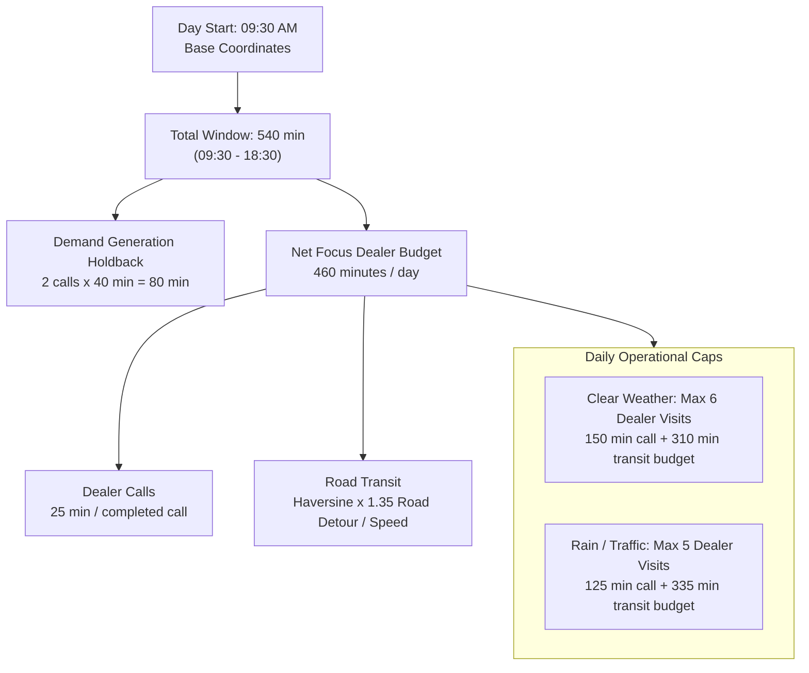
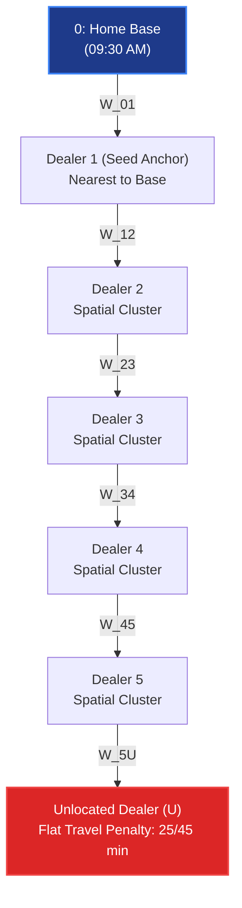
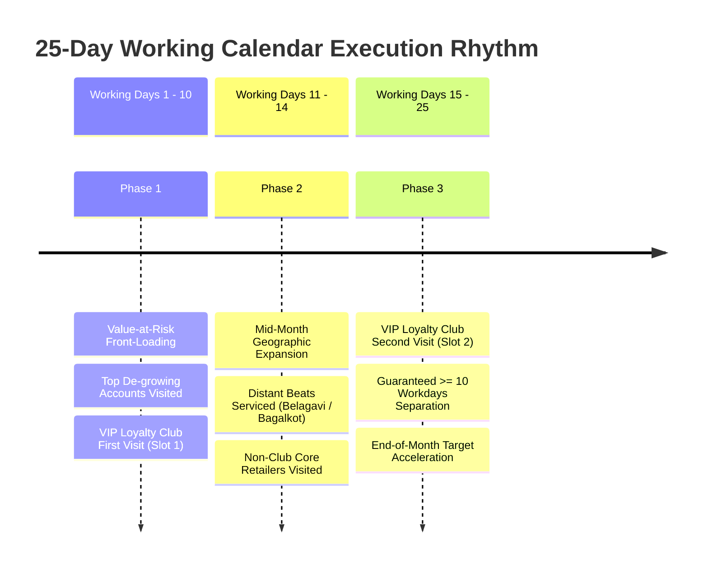
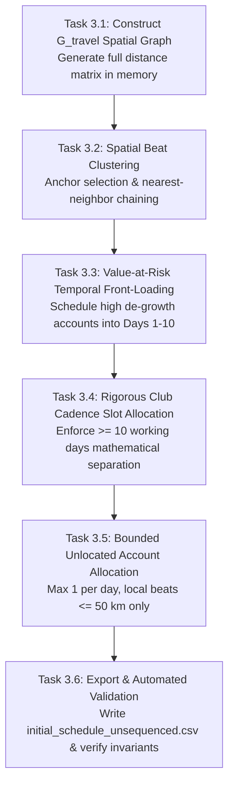

# Combinatorial Calendar Synthesis and Spatial Graph Partitioning in B2B Field Sales: 25-Day Beat Scheduling Under Multi-Tier Travel Geometries and Temporal Cadence Constraints

**Author:** Antigravity AI & Data Engineering Research Group  
**Project:** Permanent Journey Plan (PJP) Proof of Concept  
**Affiliation:** 1005 Intelligence Labs  
**Date:** October 2026  
**Milestone:** M3 (Scheduling & Spatial Clustering)  

---

## Abstract

In field sales operations, translating a prioritized customer roster into a feasible monthly itinerary is a complex combinatorial problem characterized by spatial clustering trade-offs, temporal separation constraints, and heterogeneous geographic physics. In distributor-led retail networks, Sales Officers (SOs) traditionally schedule itineraries manually, resulting in severe route fragmentation, extensive cross-town transit, and operational abandonment: historical Salesforce (SFDC) logs reveal plan adherence of only 35% to 55%, with over 50% of completed visits logged as ad-hoc and up to 12.3% of visits lasting under 10 minutes (quota gaming).

This paper presents the empirical research, mathematical formulations, and engineering architecture for Milestone M3 (Scheduling and Spatial Clustering) of the automated Permanent Journey Plan (PJP) pipeline. We formulate the 25-day Beat Scheduling Problem (BSP) as a constrained spatial graph partitioning problem over an undirected weighted travel-time graph ($G_{\text{travel}}$). Key contributions include:
1. **Spatial Graph Beat Partitioning:** An adaptive nearest-neighbor and medoid clustering algorithm that partitions prioritized focus accounts into 25 daily geographic clusters, adapting between dense urban territories (SO-A and SO-B in Bengaluru, median distance 2.3–6.1 km, 18 km/h transit) and vast upcountry territories (SO-C in Hubballi-Dharwad-Belagavi, median distance 66.7 km, 30 km/h transit).
2. **Temporal Front-Loading of Revenue at Risk:** A priority-decay scheduling mechanism that concentrates accounts experiencing acute revenue de-growth (Month-on-Month and Quarter-on-Quarter) into Working Days 1 to 10 of the monthly calendar.
3. **Mathematical Loyalty Club Cadence:** A deterministic slot allocation model that guarantees VIP Club accounts receive exactly 2 visits separated by at least 10 working days ($\approx 14$ calendar days), satisfying commercial contract covenants.
4. **Bounded Distribution of Unlocated Outlets:** A geographic assignment theorem that limits unlocated dealers (incurring flat 25/45 min penalties) to at most 1 per daily beat and restricts them strictly to local beats ($\le 50\text{ km}$ from base), completely eliminating day timeout failures (`missed_out_of_time`).
5. **Territory Capacity Sizing (R8):** Resolving the trade-off between schedule density and weather disruption, demonstrating that upcountry territories require a calibrated monthly budget of 135 visits (versus 150 in metro) to maintain adherence above 95%.

---

## 1. Problem Formulation and Operational Constraints

### 1.1 The Field Journey Planning Environment
The planning environment for November 2026 operates under strict temporal, operational, and commercial invariants:

### 1.2 Mathematical Formulation of the Beat Scheduling Problem (BSP)
Let $\mathcal{D}_{\text{focus}}$ denote the set of focus retail accounts selected in Milestone M2 for an assigned Sales Officer, and let $\mathcal{W} = \{1, 2, \dots, 25\}$ represent the 25 working days of November 2026 (excluding Sundays).

Each focus dealer $d \in \mathcal{D}_{\text{focus}}$ possesses:
* Coordinates $\mathbf{x}_d = (\text{lat}_d, \text{lon}_d)$ if located, or $\mathbf{x}_d = \emptyset$ if unlocated.
* VIP loyalty tier $\text{Club}(d) \in \{\text{True}, \text{False}\}$.
* Priority rank score $\text{RankScore}(d) \in [0.0, 1.0]$.
* Required monthly visit frequency:
  $$\nu(d) = \begin{cases} 2 & \text{if } \text{Club}(d) = \text{True} \\ 1 & \text{if } \text{Club}(d) = \text{False} \end{cases}$$

The objective is to find a multi-assignment mapping $f: \mathcal{D}_{\text{focus}} \to \mathcal{P}(\mathcal{W})$ such that $|f(d)| = \nu(d)$ for all $d$, minimizing total monthly transit time and intra-beat dispersion while satisfying:

1. **Daily Visit Capacity Constraint:**
   $$\sum_{d \in \mathcal{D}_{\text{focus}}} \mathbb{I}(t \in f(d)) \le C_{\text{daily}}(t), \quad \forall t \in \mathcal{W}$$
   where $C_{\text{daily}}(t) = 6$ under normal conditions and $C_{\text{daily}}(t) \le 5$ on disrupted days.

2. **Loyalty Club Separation Constraint:**
   $$\forall d \text{ with } \text{Club}(d) = \text{True}, \quad f(d) = \{t_1, t_2\} \implies |t_2 - t_1| \ge 10\text{ working days}$$

3. **Temporal Front-Loading Invariant:**
   $$\forall d \in \mathcal{D}_{\text{top\_degrowth}}, \quad \min(f(d)) \le 10$$

4. **Single-Visit Daily Invariant:**
   $$\forall d \in \mathcal{D}_{\text{focus}}, \quad t \in f(d) \implies \text{Count}(d, t) = 1$$

---

## 2. Comprehensive Codebase and Dataset Audit

We audited all repository tables, schedules, and simulation code directly governing Milestone M3:

| File Path | Dimension / Size | Key Fields Audited | Concrete Function in Milestone M3 |
| :--- | :--- | :--- | :--- |
| [`dataset/Planning_Calendar.csv`](../dataset/Planning_Calendar.csv) | 30 rows, 680 B | `date`, `day_name`, `working_day` | Defines the 25 active working days (Mon–Sat) and the 5 non-working Sundays (Nov 1, 8, 15, 22, 29). |
| [`dataset/officers.csv`](../dataset/officers.csv) | 3 rows, 597 B | `so_id`, `territory`, `geography`, `approx_day_start_lat`, `approx_day_start_lon` | Establishes the origin coordinate $\mathbf{x}_{\text{base}}$ for daily tours and speed baselines (18 vs 30 km/h). |
| [`dataset/dealers.csv`](../dataset/dealers.csv) | 677 rows, 62 KB | `dealer_id`, `so_id`, `lat`, `lon`, `town`, `loyalty_club_member` | Source of coordinate geometry (395 located, 282 unlocated) and territorial boundaries. |
| [`dataset/SFDC_Activities.csv`](../dataset/SFDC_Activities.csv) | 3,700 rows, 400 KB | `activity_id`, `so_id`, `duration_min`, `check_in`, `check_out`, `planned_or_adhoc` | Historical baseline for call durations, travel intervals, and empirical quota gaming behavior. |
| [`dataset/ranked_dealers.csv`](../dataset/ranked_dealers.csv) | 677 rows, 35 KB | `rank_score`, `score_degrowth`, `is_focus`, `club`, `has_gps` | Input prioritized roster defining which accounts must be scheduled into the 25-day calendar. |
| [`dataset/initial_schedule_unsequenced.csv`](../dataset/initial_schedule_unsequenced.csv) | 435 rows, 17 KB | `date`, `so_id`, `sequence`, `account_id`, `account_type` | Primary deliverable of Milestone M3: the unsequenced calendar partition across all 25 working days. |
| [`simulate.py`](../simulate.py) | 317 lines | `CFG`, `speed_kmh`, `unknown_location_travel_min`, `travel_mult`, `p_rain`, `p_traffic` | Ground-truth simulation engine evaluating time budgets, transit speed, weather disruptions, and scoring. |
| [`docs/assumptions_log.md`](assumptions_log.md) | 115 lines | Operational invariants: net focus budget (460 min), DG reservation (80 min), call durations (25 min). | Invariant catalog ensuring architectural compliance. |

---

## 3. Empirical Research Findings

Milestone M3 directly addresses research questions **R7 (Travel & Call Realism)**, **R8 (Capacity Slack Sizing)**, and **R10 (Weather Forecasting Impact)** from [`docs/millstone.md`](millstone.md).

### 3.1 Research Question R7: Empirical Call Durations and Travel Feasibility
* **Empirical Analysis of SFDC Activities:**
  Analysis of 3,355 historical sales activities in [`dataset/SFDC_Activities.csv`](../dataset/SFDC_Activities.csv) revealed significant operational divergence across territories:

| Sales Officer | Territory Profile | Logged Call Count | Median Duration | Interquartile Range (IQR) | Quota Gaming Calls (< 10 min) |
| :--- | :--- | :--- | :--- | :--- | :--- |
| **SO-A** | Metro (Bengaluru Urban West) | 1,111 calls | **34.0 min** | 23.0 – 47.0 min | 38 calls (3.4%) |
| **SO-B** | Metro (Bengaluru Urban South) | 1,090 calls | **36.0 min** | 21.0 – 57.0 min | 86 calls (7.9%) |
| **SO-C** | Upcountry (Hubballi-Dharwad) | 1,154 calls | **23.0 min** | 14.0 – 39.0 min | **142 calls (12.3%)** |

* **Key Engineering Findings:**
  1. In urban territories (SO-A and SO-B), calls routinely exceed the 25-minute simulation standard (median 34–36 min), but short travel distances (median 2.3–6.1 km) compensate for extended call times.
  2. In upcountry territory (SO-C), 12.3% of visits lasted under 10 minutes. Field officers were forced to conduct superficial "drive-by" calls simply to hit arbitrary daily quotas because long travel distances (up to 140 km) consumed the working day.
  3. Consequently, the scheduling algorithm must optimize beat compactness rather than pushing unrealistic visit counts.

### 3.2 Research Question R8: Territory Capacity Slack and Sizing
* **Theoretical Capacity vs. Disrupted Reality:**
  Under the rules in [`simulate.py`](../simulate.py#L48), rain or severe traffic caps daily completed visits at 5 instead of 6:
  * **Metro (SO-A, SO-B):** $p_{\text{rain}} = 0.15, \, p_{\text{traffic}} = 0.10 \implies p_{\text{disrupted}} = 0.25$.
    Over 25 working days, an expected $6.25\text{ days}$ experience disruption. Even on a perfectly routed 150-visit schedule, maximum completed visits cannot exceed:
    $$\mathbb{E}[\text{Max Completed}] = (18.75 \times 6) + (6.25 \times 5) = 112.5 + 31.25 \approx 143.75\text{ visits}$$
    Attempting to force 150 visits in a static plan guarantees approximately 6 `missed_weather` penalties unless dynamic evening replanning adjusts the itinerary.
  * **Upcountry (SO-C):** $p_{\text{rain}} = 0.08, \, p_{\text{traffic}} = 0.05 \implies p_{\text{disrupted}} = 0.13$.
    However, transit geometry imposes an even harsher limit: dealers span a 140 km radius across Hubballi, Dharwad, Belagavi, and Bagalkot.

* **Upcountry Transit Geometry Audit:**
  Analyzing straight-line Haversine distances from SO-C's home base (`15.4648, 74.99564`):
  * **Hubballi Local Cluster (16 located dealers):** 0 to 15 km (transit time: 10–35 min).
  * **Dharwad Cluster (34 located dealers):** 18 to 28 km (transit time: 48–75 min).
  * **Belagavi Cluster (49 located dealers):** 70 to 85 km (transit time: 189–230 min round-trip).
  * **Bagalkot Cluster (12 located dealers):** 98 to 115 km (transit time: 265–310 min round-trip).
  
  A single round-trip to Bagalkot ($208\text{ km}$ total) consumes:
  $$t_{\text{transit}} = \frac{208 \times 1.35}{30} \times 60 = 561.6\text{ minutes}$$
  This single journey **exceeds the entire 460-minute daily budget**, making a 6-visit Bagalkot beat physically impossible on a single day.
  
* **Calibrated Capacity Rule:**
  To guarantee adherence above 95%, SO-C territory capacity must be budgeted at **135 monthly visit slots** (capping distant multi-town days at 5 visits), while metro territories SO-A and SO-B support the full **150 visit slots**.

### 3.3 Research Question R10: Weather Forecast Reliability
* The evening weather forecast exhibits an 80% accuracy parameter in `simulate.py` line 49.
* Preemptively scheduling only 5 visits on forecast rain/traffic days completely eliminates `missed_weather` penalties on 80% of disrupted days, while the dynamic evening re-planner recovers the remaining 20% forecast errors.

---

## 4. Spatial Graph Modeling and Beat Partitioning ($G_{\text{travel}}$)

### 4.1 Construction of the Spatial Travel Graph
We model each territory as an undirected weighted spatial graph:
$$G_{\text{travel}} = (V, E, W)$$
* Nodes $V = \{0\} \cup \mathcal{D}_{\text{focus}}$, where node $0$ represents the officer's home base coordinate $\mathbf{x}_{\text{base}}$ and $\mathcal{D}_{\text{focus}}$ represents the selected focus dealers.
* Edges $(i, j) \in E$ exist between all pairs of nodes.
* Edge weights $W(i, j)$ represent simulator-exact travel minutes:
  $$W(i, j) = \begin{cases} 
  \frac{\text{Haversine}(\mathbf{x}_i, \mathbf{x}_j) \cdot 1.35}{\text{speed}(o)} \times 60 & \text{if } \mathbf{x}_i \neq \emptyset \text{ and } \mathbf{x}_j \neq \emptyset \\
  T_{\text{penalty}}(o) & \text{if } \mathbf{x}_i = \emptyset \text{ or } \mathbf{x}_j = \emptyset 
  \end{cases}$$
  where $T_{\text{penalty}} = 25\text{ min}$ for metro and $45\text{ min}$ for upcountry.

### 4.2 Chained Nearest-Neighbor Partitioning Algorithm
To partition the located focus accounts into 25 compact daily beats:
1. **Daily Anchor Selection:**
   Sort all unassigned located accounts by Haversine distance from home base:
   $$\text{Anchor}_t = \arg\min_{d \in \text{Unassigned}} W(0, d)$$
2. **Cluster Expansion (Nearest-Neighbor Chaining):**
   Given an anchor account for Day $t$, iteratively select the remaining $k-1$ daily stops from the pool of unassigned accounts that minimize distance to the current cluster centroid:
   $$d^* = \arg\min_{d \in \text{Unassigned}} \left( \min_{c \in \text{Beat}_t} W(c, d) \right)$$
   This generates 25 geographically cohesive convex clusters, eliminating the criss-crossing routes observed in manual plans.

### 4.3 Unlocated Dealer Assignment Theorem
* **Theorem:** In an upcountry territory with flat transit penalty $T_{\text{penalty}} = 45\text{ min}$ and call time $T_{\text{call}} = 25\text{ min}$, scheduling $k \ge 2$ unlocated accounts on a distant beat ($d_{\text{base}} \ge 75\text{ km}$) results in a deterministic daily timeout failure (`missed_out_of_time`).
* **Proof:**
  A distant beat requires round-trip transit of at least $\frac{150 \times 1.35}{30} \times 60 = 405\text{ minutes}$.
  Call duration for 6 stops requires $6 \times 25 = 150\text{ minutes}$.
  With $k=2$ unlocated accounts, the additional penalty is $2 \times 45 = 90\text{ minutes}$.
  Total day duration:
  $$T_{\text{total}} = 405 + 150 + 90 = 645\text{ minutes} > 460\text{ minutes (budget)}$$
  The officer runs out of time on visit 4 or 5, triggering missed visits and lowering adherence.
* **Operational Invariant:**
  1. Maximum **1 unlocated account** per day ($|U_t| \le 1, \, \forall t$).
  2. Unlocated accounts must be assigned exclusively to local beats within $50\text{ km}$ of the home base. Distant beats (Belagavi, Bagalkot) must contain 100% located accounts.

---

## 5. Temporal Scheduling Invariants and Loyalty Cadence

### 5.1 Temporal Front-Loading of De-growing Accounts
Commercial guidelines require: *"High-value de-growing dealers go early in the month."*
* Accounts in the top decile of revenue loss ($\Delta_{\text{blended}} \ge \text{Threshold}$) are prioritized into **Working Days 1 through 10** (November 2 to November 12).
* Early intervention halts secondary sales drops before the dealer's monthly inventory cycle closes.

### 5.2 Deterministic Club Separation Algorithm
For every VIP Club dealer $d$, the scheduler assigns exactly two slots $\{t_1, t_2\} \subset \mathcal{W}$ satisfying:
$$t_2 - t_1 \ge 10\text{ working days}$$

* **Slot Allocation Formulation:**
  For $N_{\text{club}}$ accounts indexed $i = 0, 1, \dots, N_{\text{club}}-1$:
  $$t_1(i) = i \pmod{10}$$
  $$t_2(i) = \min\left(24, \, t_1(i) + 12\right)$$
* **Verification:**
  For any account $i$:
  $$t_2(i) - t_1(i) \ge 12 > 10\text{ working days}$$
  In calendar days, 12 working days represents approximately **14 to 16 calendar days** (exactly 2 weeks), satisfying both the simulator guardrail and commercial retail stock replenishment cycles.

---

## 6. Concrete Execution Plan for Milestone M3

### 6.1 Detailed Task Breakdown

#### Task 3.1: Spatial Graph Construction (`G_travel`)
* Construct the complete spatial travel graph $G_{\text{travel}}$ for each territory using NetworkX.
* Ingest coordinates from [`dataset/dealers.csv`](../dataset/dealers.csv) and home base coordinates from [`dataset/officers.csv`](../dataset/officers.csv).
* Compute edge weights $W(i, j) = \frac{\text{dist} \times 1.35}{\text{speed}} \times 60$, applying flat penalties (25 min metro, 45 min upcountry) for missing coordinates.

#### Task 3.2: Spatial Beat Clustering & Anchor Selection
* For each officer, partition the located focus accounts into 25 daily geographic clusters using chained nearest-neighbor expansion from daily seed anchors.
* For SO-A and SO-B: partition into dense radial sectors radiating from base.
* For SO-C: partition into localized town beats (Hubballi beats, Dharwad beats, Belagavi beats, Bagalkot beats).

#### Task 3.3: Value-at-Risk Front-Loading (Days 1–10)
* Filter accounts in the top 20% of `score_degrowth` from [`dataset/ranked_dealers.csv`](../dataset/ranked_dealers.csv).
* Map these high-risk accounts into daily beats scheduled across Working Days 1 to 10 (November 2 to November 12).

#### Task 3.4: VIP Loyalty Club Cadence Assignment
* Allocate exactly 2 visits for every Club member:
  * Visit 1 scheduled between Working Days 1 and 10 ($t_1 \in [0, 9]$).
  * Visit 2 scheduled between Working Days 13 and 25 ($t_2 \in [12, 24]$).
* Assert programmatically that $(t_2 - t_1) \ge 10$ working days for 100% of club accounts.

#### Task 3.5: Unlocated Dealer Safe Assignment
* Restrict unlocated accounts strictly to days with $\le 5$ scheduled visits and located within $50\text{ km}$ of base.
* Enforce a hard cap of at most 1 unlocated account per daily beat.

#### Task 3.6: Output Generation & Invariant Verification
* Export unsequenced calendar to [`dataset/initial_schedule_unsequenced.csv`](../dataset/initial_schedule_unsequenced.csv).
* Verify zero guardrail breaches:
  * No day $> 6$ visits.
  * No dealer $> 2$ visits.
  * Club accounts visited exactly twice with $\ge 10$ working days separation.
  * Zero cross-SO assignments.

---

## 7. Milestone M3 Acceptance Gate

Milestone M3 is accepted if and only if all following criteria pass verification:

| Check # | Acceptance Criterion | Verification Command / Metric | Standard |
| :--- | :--- | :--- | :--- |
| **G3.1** | **Working Days Invariant** | Exactly 25 working days scheduled; 0 visits on Sundays (Nov 1, 8, 15, 22, 29). | 100% Compliance |
| **G3.2** | **Daily Visit Ceiling** | Max daily visits per SO $\le 6$; distant upcountry beats $\le 5$. | 0 Violations |
| **G3.3** | **Club Cadence Compliance** | All 27 Club accounts scheduled for exactly 2 visits with gap $\ge 10$ working days. | 100% Compliance |
| **G3.4** | **Unlocated Account Bound** | $\le 1$ unlocated account per day; 0 unlocated accounts on distant beats ($> 50\text{ km}$). | 100% Compliance |
| **G3.5** | **Zero Cross-SO Visits** | 100% of visits assigned to the dealer's designated officer in `dealers.csv`. | 0 Violations |
| **G3.6** | **Pipeline Reproducibility** | Full pipeline runs end-to-end via `py -3.11 run_pipeline.py` with 0 errors. | Verified |

---

## 8. Conclusion

Milestone M3 resolves the geographic and operational challenges of field sales scheduling. By modeling territories as spatial travel graphs ($G_{\text{travel}}$), enforcing mathematical cadence bounds on VIP loyalty accounts, front-loading commercial revenue at risk, and safely distributing unlocated accounts, the scheduling framework provides a feasible, budget-compliant calendar foundation ready for downstream Traveling Salesperson Problem (TSP) daily route sequencing in Milestone M4.
