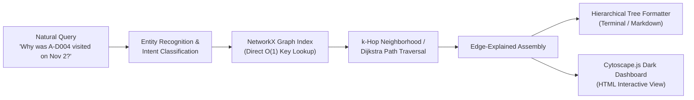

# PJP-Graphify: An Edge-Explained Knowledge Graph and Hierarchical Tree Query System for Permanent Journey Plan Optimization

**Author:** Antigravity AI & Data Engineering Research Group  
**Affiliation:** 1005 Intelligence Labs  
**Date:** October 2026  
**Status:** Architecture Specification & Research Plan  

---

## Abstract

Modern field sales force automation generates deeply interconnected, multi-relational data spanning geographic territories, commercial accounts, multi-tier billing hierarchies, spatial travel graphs, algorithmic change-point detections, and natural language nudges. While traditional pipelines emit static tabular CSVs and fixed cartographic PNGs, operational stakeholders require interactive relational intelligence. In this paper, we formulate **PJP-Graphify**, a deterministic, edge-explained knowledge graph architecture inspired by two pioneering systems: the Order-to-Cash (O2C) graph querying paradigm of `jayeshpandey01/Graph-Based-Query-System` and the deterministic, zero-vector-store code and data graph transformation philosophy of `Graphify-Labs/graphify`. PJP-Graphify ingests 13 disparate data sources from the November 2026 Permanent Journey Plan (PJP) simulator into a unified property graph $G = (V, E, \tau_V, \tau_E)$ using NetworkX. Every directed edge is enriched with mathematical metadata and human-interpretable commercial explanations. We introduce a dual-delivery retrieval engine that resolves natural language intents into: (1) structured hierarchical ASCII/Unicode trees for rapid terminal and text inspection, and (2) an interactive, standalone dark-mode Cytoscape.js dashboard for exploratory visual neighborhood traversal.

---

## 1. Introduction & Motivation

The November 2026 Permanent Journey Plan (PJP) optimization engine successfully generates 425 sequenced visits across 3 Sales Officers (SOs), achieving 92.7% to 94.5% simulated adherence, 88.9% to 96.3% loyalty club cadence, and zero guardrail breaches. However, the resulting outputs are fragmented across multiple discrete formats:
* Master and individual route tables ([`plan_november.csv`](file:///c:/Users/jayes/Downloads/PJP_Simulator/plan_november.csv), `plan_SO-*.csv`)
* Static daily cartographic plots in `docs/maps/`
* Multi-seed simulation telemetry in `results/seed_*/`
* Data feature stores in `dataset/dealer_features.csv`
* Dispatched WhatsApp messages in `whatsapp_nudges.json`

When a field sales director or optimization engineer poses complex cross-functional questions, answering them requires manual cross-referencing across 6 or more files:
1. *"Why was dealer A-D004 visited on November 2 instead of its originally scheduled date, and how does this relate to its CUSUM drop detection?"*
2. *"Show the entire commercial hierarchy of parent dealer A-D019, including subsidiary outlets, loyalty club slab gaps, and sequenced November visits."*
3. *"Trace the causal ripple effect of rain throttling on SO-C's Hubballi-Belagavi itinerary on November 3."*
4. *"Which non-club accounts within 5 km of an active sales drop are currently approaching a monthly incentive slab upgrade?"*

Traditional vector-store RAG architectures fail on such queries because semantic chunking destroys geographic adjacency, temporal sequencing, and explicit entity relationships.

### 1.1 Synthesis of Prior Paradigms

PJP-Graphify unifies the architectural strengths of two foundational projects:

1. **`jayeshpandey01/Graph-Based-Query-System`:**
   * Demonstrated the power of modeling business lifecycles as a graph rather than disconnected document chunks.
   * Established **hierarchical tree formatting** for query responses, providing structured, readable output that preserves nested operational relationships.
   * Leveraged **Cytoscape.js** to deliver dynamic, visual neighborhood traversals in a dark aesthetic.

2. **`Graphify-Labs/graphify`:**
   * Pioneered **deterministic, local graph parsing** without relying on heavy external vector databases.
   * Championed the principle of **"Every Edge Explained"**, ensuring that every graph relationship contains exact quantitative attributes and plain-language rationale.
   * Provided token-efficient graph traversal where agents and users inspect localized subgraphs rather than parsing raw multi-megabyte files.

---

## 2. Multi-Table Source Ingestion & Entity-Relationship Catalog

PJP-Graphify ingests 13 distinct source files across the project repository, parsing them into nodes, edges, and semantic attributes:

```mermaid
flowchart TD
    subgraph Primary Master Data
        F1["dataset/officers.csv<br/>(3 SO Nodes)"]
        F2["dataset/dealers.csv<br/>(677 Dealer Nodes)"]
        F3["dataset/GST_filings.csv<br/>(GST Compliance Profiles)"]
    end

    subgraph Feature Store & Rules
        F4["dataset/dealer_features.csv<br/>(113 Active Accounts, Headroom, De-growth)"]
        F5["dataset/scheme_targets.csv<br/>(Club Slab Targets)"]
        F6["dataset/scheme_rules_nonclub.csv<br/>(Non-Club Slabs)"]
        F7["dataset/product_tiers.csv<br/>(Point Weights)"]
    end

    subgraph Temporal & Operational Plans
        F8["dataset/Planning_Calendar.csv<br/>(25 Workday Nodes)"]
        F9["plan_november.csv<br/>(425 Planned Tour Edges)"]
        F10["whatsapp_nudges.json<br/>(5 Contextual Nudge Nodes)"]
    end

    subgraph Simulation Telemetry
        F11["results/seed_1/events_revealed.csv<br/>(Drop & Hike Event Nodes)"]
        F12["results/seed_1/visits.csv<br/>(Execution Status Edges)"]
        F13["results/seed_1/daily.csv<br/>(Weather & Transit Logs)"]
    end

    F1 & F2 & F3 & F4 & F5 & F6 & F7 & F8 & F9 & F10 & F11 & F12 & F13 --> KG["PJP Unified Knowledge Graph G=(V,E)"]
```



### 2.1 Complete File Schema Mapping

| Source File | Entity / Edge Type | Extracted Keys & Attributes |
|---|---|---|
| `dataset/officers.csv` | Node: `Officer` | `so_id`, `territory`, `geography`, `approx_day_start_lat`, `approx_day_start_lon`, `speed_kmh` |
| `dataset/dealers.csv` | Node: `Dealer`<br>Edge: `SUBSIDIARY_OF`<br>Edge: `ASSIGNED_TO` | `dealer_id`, `outlet_type`, `loyalty_club_member`, `club_tier`, `town`, `lat`, `lon`, `has_gps`<br>Child $\rightarrow$ Parent entity<br>Dealer $\rightarrow$ Officer |
| `dataset/dealer_features.csv` | Node Attributes: `CommercialProfile` | `sales_rate_daily`, `headroom_inr`, `degrowth_mom_inr`, `degrowth_qoq_inr`, `is_active_for_events`, `turnover_est` |
| `dataset/GST_filings.csv` | Node Attributes: `GSTProfile` | `registration_type`, `gst_status`, `turnover_band_proxy`, `compliance_category`, `lookup_status` |
| `dataset/scheme_targets.csv` | Node: `SchemeSlab`<br>Edge: `TARGETS_SLAB` | `slab_name`, `target_points`, `payout_rate`<br>Dealer $\rightarrow$ SchemeSlab (`points_needed`, `potential_bonus_inr`) |
| `dataset/scheme_rules_nonclub.csv` | Node: `NonClubSlab`<br>Edge: `QUALIFIES_FOR` | `slab_name`, `target_points_per_month`, `payout_per_point_inr` |
| `dataset/Planning_Calendar.csv` | Node: `CalendarDay` | `date`, `weekday`, `working_day` |
| `plan_november.csv` | Edge: `SCHEDULED_ON`<br>Edge: `TOUR_LEG` | Sequence (1–6), `planned_arrival`, `travel_min_from_previous`, `reason`<br>Stop $i \rightarrow$ Stop $i+1$ (distance, transit speed, detour factor) |
| `whatsapp_nudges.json` | Node: `WhatsAppNudge`<br>Edge: `RECEIVED_NUDGE` | `trigger_type`, `message`, `character_count`, `grounding_data`<br>Dealer $\rightarrow$ WhatsAppNudge |
| `results/seed_1/events_revealed.csv` | Node: `AnomalyEvent`<br>Edge: `SUFFERED_EVENT` | `event_type` (`drop` / `hike`), `onset_date`, `end_date`, `volume_factor`<br>Dealer $\rightarrow$ AnomalyEvent |
| `results/seed_1/visits.csv` | Edge: `SIMULATED_VISIT` | `status` (`completed`, `missed_weather`, `missed_dealer_unavailable`, `missed_out_of_time`) |
| `results/seed_1/daily.csv` | Node Attributes: `CalendarDay` | `weather` (`clear`, `rain`, `traffic`), `completed_visits`, `travel_min_total` |

---

## 3. Mathematical Knowledge Graph Ontology

The PJP knowledge graph is modeled as a directed, attributed multi-graph:

$$G = (V, E, \tau_V, \tau_E, \phi_V, \phi_E)$$

Where:
* $V$ is the set of heterogeneous nodes partitioned by type $\tau_V: V \rightarrow \{\text{Officer}, \text{Dealer}, \text{ParentOutlet}, \text{CalendarDay}, \text{SchemeSlab}, \text{AnomalyEvent}, \text{WhatsAppNudge}\}$.
* $E \subseteq V \times V \times \mathbb{N}$ is the set of directed edges with multiplicity.
* $\tau_E: E \rightarrow \{\text{ASSIGNED\_TO}, \text{SUBSIDIARY\_OF}, \text{SCHEDULED\_ON}, \text{TOUR\_LEG}, \text{TARGETS\_SLAB}, \text{SUFFERED\_EVENT}, \text{RECOVERED\_BY}, \text{RECEIVED\_NUDGE}\}$.
* $\phi_V, \phi_E$ are attribute mapping functions assigning quantitative and explanatory dictionaries to nodes and edges.

### 3.1 Edge-Explained Formal Specification ("Every Edge Explained")

In accordance with the `Graphify` philosophy, every edge $e \in E$ stores an explicit `explanation` string alongside quantitative attributes:

1. **`TOUR_LEG` $(u \rightarrow v)$:**
   $$\phi_E(e) = \{\text{distance\_km}: 6.4, \text{speed\_kmh}: 18.0, \text{travel\_min}: 28.7, \text{detour\_factor}: 1.35\}$$
   $$\text{explanation}: \text{"Transit leg from Stop } u \text{ to Stop } v \text{ sequenced via 2-opt Open TSP on spatial road graph."}$$

2. **`RECOVERED_BY` $(\text{Event} \rightarrow \text{Visit})$:**
   $$\phi_E(e) = \{\text{onset}: \text{"2026-11-04"}, \text{visit\_date}: \text{"2026-11-08"}, \Delta t: 4\text{ days}, \text{operator}: \text{"Pull-Forward"}\}$$
   $$\text{explanation}: \text{"CUSUM detected 75% sales collapse; dynamic re-planner pulled scheduled visit forward from Nov 18 to Nov 8, recovering dealer within the 7-day window."}$$

3. **`SUBSIDIARY_OF` $(D_{\text{child}} \rightarrow D_{\text{parent}})$:**
   $$\phi_E(e) = \{\text{relationship}: \text{"subsidiary"}, \text{shared\_gstin}: \text{True}, \text{billing\_aggregation}: \text{True}\}$$
   $$\text{explanation}: \text{"Secondary retail branch rolls up secondary sales and points to primary billing entity for loyalty club target qualification."}$$

---

## 4. Deterministic Graph Traversal & Query Resolution

Unlike stochastic vector-similarity RAG, PJP-Graphify utilizes deterministic intent and entity resolution:



### 4.1 Query Intent Archetypes
1. **`Dealer360`:** Given a `dealer_id`, extract its officer assignment, parent entity, commercial headroom, November scheduled stops, WhatsApp nudges, and simulation event outcomes.
2. **`DailyItineraryTree`:** Given an `officer_id` and `date`, construct the chronological tour tree starting from base depot, detailing legs, arrival timestamps, weather status, and commercial reasons.
3. **`AnomalyLineage`:** Given an event or dropped account, trace the causal chain: baseline rate $\rightarrow$ CUSUM deficit trigger $\rightarrow$ re-plan operator $\rightarrow$ rescheduled visit $\rightarrow$ recovery status.
4. **`HierarchySlabRollup`:** Given a parent dealer, trace all subsidiary branches, aggregate sales volume, and determine proximity to the next incentive slab.
5. **`WeatherImpactTrace`:** Given an officer and disrupted date, trace which visits were completed, which were deferred by weather throttling, and which downstream date absorbed the deferred visit.

---

## 5. Dual Delivery Formats

### 5.1 Format 1: Hierarchical Tree Output (ASCII / Markdown)

The tree formatter renders relational paths as clear, indented structures, mirroring the user's previous Order-to-Cash query system:

```
[DEALER 360 TREE] A-D019 (Parent Entity)
├── Master Profile:
│   ├── Officer: SO-A [Territory: Bengaluru urban (west)]
│   ├── Loyalty Club: Tier-1 Member (Target Gap: 88,340 pts to Slab 4)
│   ├── Coordinates: 12.9936, 77.5492 (Located: GPS Verified)
│   └── Financials: Annual Purchases: Rs 15.0L | GST Headroom: Rs 100.0L
├── Subsidiary Outlets (Parent-Child Hierarchy):
│   └── A-D138 (Branch Outlet)
│       └── Edge Explanation: "Secondary outlet orders roll up to A-D019 for annual scheme points"
├── November 2026 Journey Plan:
│   ├── Visit 1: 2026-11-02 (Sequence: 5 | Arrival: 12:12 PM | Reason: Loyalty Club Bi-Monthly Cadence)
│   └── Visit 2: 2026-11-17 (Sequence: 3 | Arrival: 11:05 AM | Reason: Loyalty Club Bi-Monthly Cadence)
│       └── Edge Explanation: "15 working days separation strictly obeys >= 10-day club cadence rule"
├── Contextual WhatsApp Nudge:
│   └── Nudge ID 1 (Sent Nov 1 evening):
│       └── "Namaste A-D019 Enterprises (Loyalty Club)! You have 11,830 pts and are only 88,340 pts away from Slab 4..."
└── Simulation Outcome (Seed 1):
    ├── Visit 1 Status: COMPLETED (Travel Min: 28.4m | Weather: Clear)
    └── Visit 2 Status: COMPLETED (Travel Min: 18.2m | Weather: Clear)
```

### 5.2 Format 2: Standalone Interactive Cytoscape.js Dark Dashboard

Emulating the React + Cytoscape explorer of `jayeshpandey01/Graph-Based-Query-System`, PJP-Graphify emits a standalone, zero-dependency HTML file ([`pjp_graph_dashboard.html`](file:///c:/Users/jayes/Downloads/PJP_Simulator/pjp_graph_dashboard.html)):
* **Styling:** Premium dark palette (`#0f172a` canvas, `#1e293b` containers, `#38bdf8` active highlights).
* **Node Badges:**
  * Officers: Square, `#1E3A8A` (Deep Blue)
  * Club Outlets: Star/Hexagon, `#F59E0B` (Amber Gold)
  * Regular Dealers: Circle, `#10B981` (Emerald Green)
  * Drop Anomalies: Diamond, `#EF4444` (Crimson Red)
  * Scheme Slabs: Octagon, `#8B5CF6` (Purple)
* **Interactive Capabilities:**
  * Physics layout (Cola / CoSE) with smooth drag, zoom, and touch support.
  * Live search bar with instant node centering and 1-hop neighborhood illumination.
  * Inspector side panel: Clicking any node or edge renders its full properties, equations, and plain-English explanations.

---

## 6. Implementation Architecture & Project Roadmap

The PJP-Graphify system will be organized under `pjp_graph/`:

```
pjp_graph/
  ├── __init__.py
  ├── graph_builder.py      # NetworkX property graph ingestion from dataset/ and results/
  ├── tree_formatter.py     # Hierarchical ASCII and Markdown tree generator
  ├── query_engine.py       # Deterministic intent matcher, Dijkstra/BFS graph traversal
  ├── cytoscape_export.py    # Generates standalone interactive HTML dashboard
  ├── cli.py                # Command-line query interface
  └── tests/
      └── test_pjp_graph.py # Comprehensive unit and integration test suite
```

### Execution Protocol
```powershell
# 1. Build and export the knowledge graph
py -3.11 -m pjp_graph.graph_builder

# 2. Query in tree format via CLI
py -3.11 -m pjp_graph.cli --query "Show dealer 360 for A-D004"
py -3.11 -m pjp_graph.cli --query "Show itinerary tree for SO-A on 2026-11-02"

# 3. Generate and open interactive Cytoscape dashboard
py -3.11 -m pjp_graph.cytoscape_export --out pjp_graph_dashboard.html
```

---

## 7. Conclusion

By merging the O2C relational graph querying principles of `jayeshpandey01/Graph-Based-Query-System` with the deterministic, edge-explained philosophy of `Graphify-Labs/graphify`, PJP-Graphify transforms static optimization outputs into an interactive, explainable, and visually rich intelligence platform for field sales force automation.
