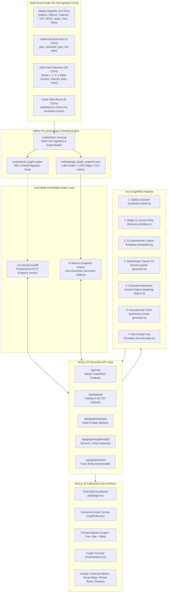
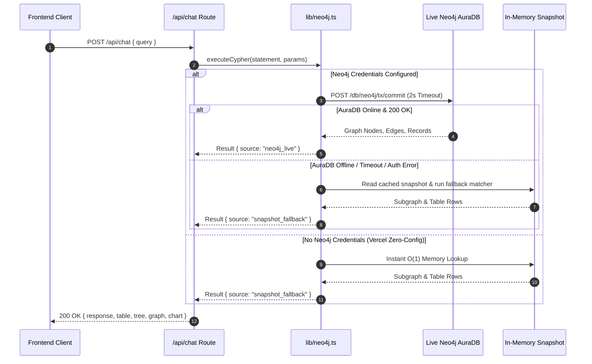
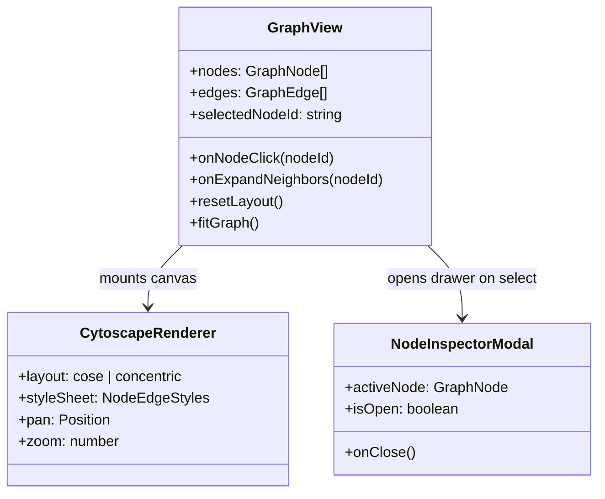
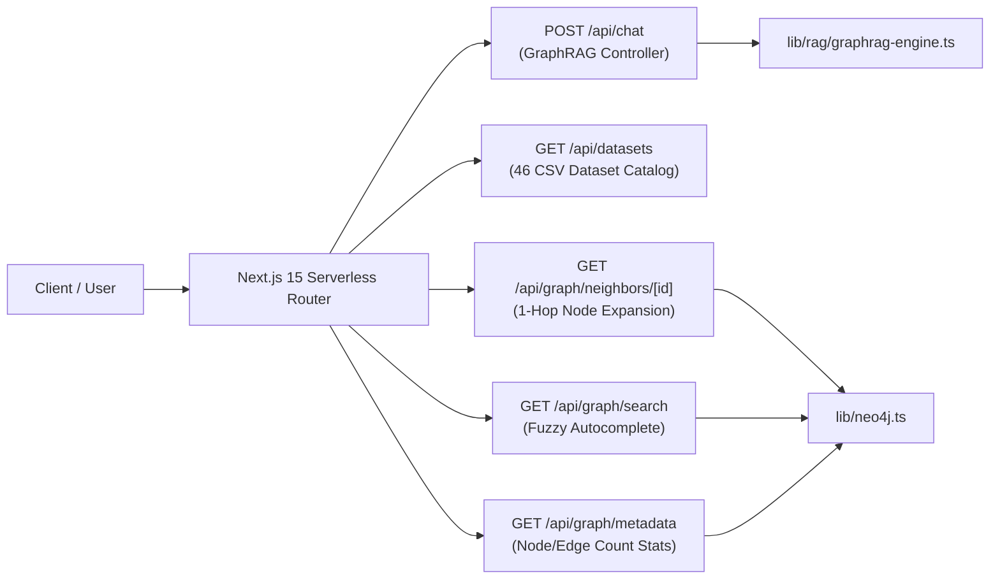
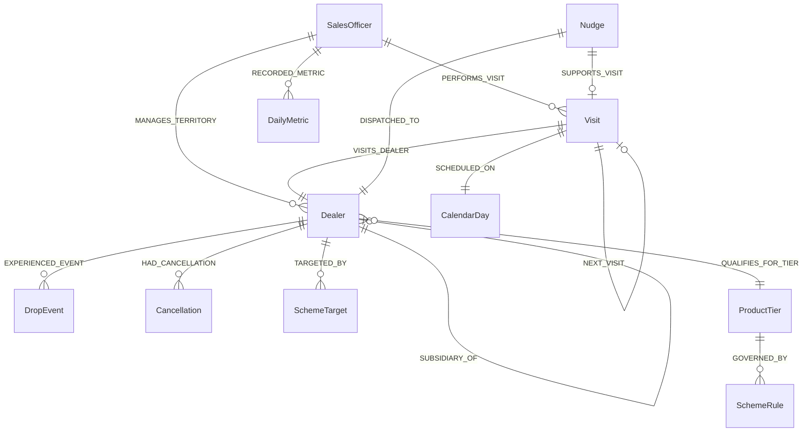
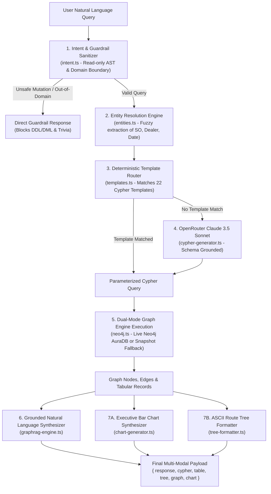
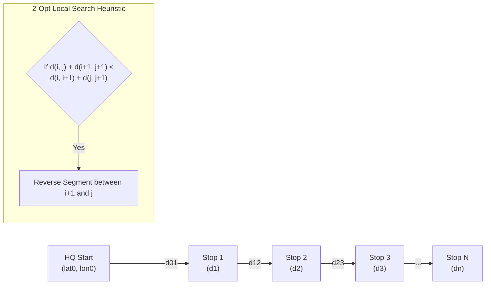
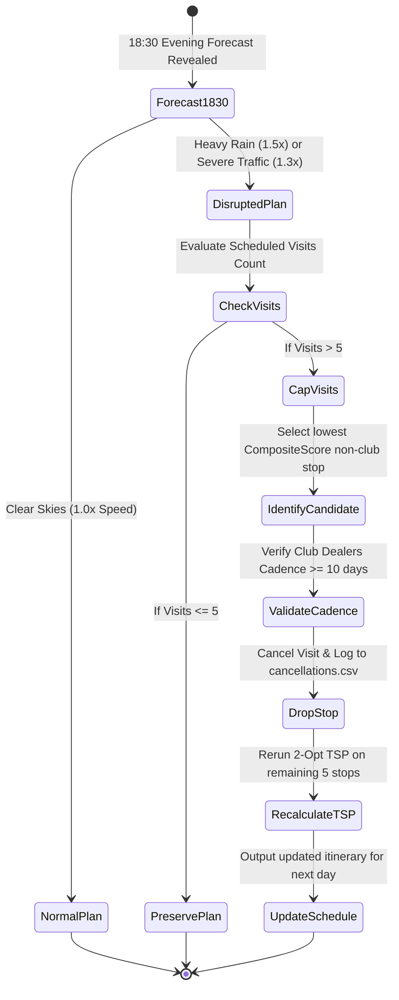

# Permanent Journey Plan (PJP) System Architecture Document

> **Authoritative Technical Blueprint for the PJP Sales Optimization & GraphRAG Copilot Platform**  
> **Platform Stack:** Next.js 15 (App Router, React 19) • Neo4j AuraDB • Cytoscape.js • OpenRouter (Claude 3.5 Sonnet) • Python 3.11 Optimization Engine  
> **Repository:** `1005_labs` • **Modeled After:** [`jayeshpandey01/Graph-Based-Query-System`](https://github.com/jayeshpandey01/Graph-Based-Query-System)  
> **Live Production Dashboard:** [https://1005-labs.vercel.app](https://1005-labs.vercel.app)

---

## Table of Contents
1. [Overall System Architecture](#1-overall-system-architecture)
   - 1.1 [High-Level Architectural Topology](#11-high-level-architectural-topology)
   - 1.2 [End-to-End Data Pipeline](#12-end-to-end-data-pipeline)
   - 1.3 [Technology Stack & Component Matrix](#13-technology-stack--component-matrix)
   - 1.4 [Zero-Downtime Dual-Mode Resilience Model](#14-zero-downtime-dual-mode-resilience-model)
2. [Frontend Architecture & Setup](#2-frontend-architecture--setup)
   - 2.1 [Next.js 15 App Shell & Server/Client Boundaries](#21-nextjs-15-app-shell--serverclient-boundaries)
   - 2.2 [Cyberpunk UI Design System & Component Hierarchy](#22-cyberpunk-ui-design-system--component-hierarchy)
   - 2.3 [Interactive Cytoscape.js Visual Canvas](#23-interactive-cytoscapejs-visual-canvas)
   - 2.4 [Multi-Format Visualization Switcher](#24-multi-format-visualization-switcher)
   - 2.5 [Modal Ecosystem & State Management](#25-modal-ecosystem--state-management)
3. [Backend & AI System Design](#3-backend--ai-system-design)
   - 3.1 [Serverless API Route Architecture](#31-serverless-api-route-architecture)
   - 3.2 [Knowledge Graph Property Model (1,902 Nodes, 3,056 Edges)](#32-knowledge-graph-property-model-1902-nodes-3056-edges)
   - 3.3 [Seven-Stage GraphRAG Pipeline](#33-seven-stage-graphrag-pipeline)
   - 3.4 [Safety Guardrails & Domain Boundary Filters](#34-safety-guardrails--domain-boundary-filters)
   - 3.5 [Deterministic Cypher Template Engine](#35-deterministic-cypher-template-engine)
   - 3.6 [Executive Bar Chart & ASCII Tree Synthesizers](#36-executive-bar-chart--ascii-tree-synthesizers)
4. [Calculation & Algorithmic Engine](#4-calculation--algorithmic-engine)
   - 4.1 [Multi-Factor Composite Dealer Ranking](#41-multi-factor-composite-dealer-ranking)
   - 4.2 [25-Day Beat Scheduling & Frequency Constraints](#42-25-day-beat-scheduling--frequency-constraints)
   - 4.3 [Spatial Graph & 2-Opt TSP Route Sequencing](#43-spatial-graph--2-opt-tsp-route-sequencing)
   - 4.4 [Daily Time Budget & Transit Physics Equations](#44-daily-time-budget--transit-physics-equations)
   - 4.5 [CUSUM Anomaly Detection & Sales Spike Models](#45-cusum-anomaly-detection--sales-spike-models)
   - 4.6 [Personalized WhatsApp Nudge Generation](#46-personalized-whatsapp-nudge-generation)
   - 4.7 [Dynamic Evening Re-planning Engine (`mypjp.replan`)](#47-dynamic-evening-re-planning-engine-mypjpreplan)

---

## 1. Overall System Architecture

The Permanent Journey Plan (PJP) platform is an enterprise-grade AI copilot and optimization engine designed to maximize sales officer field coverage, restore de-growth accounts, capture high-margin wallet headroom, and guarantee strict compliance with physical transit and labor constraints.

### 1.1 High-Level Architectural Topology



---

### 1.2 End-to-End Data Pipeline

The operational lifecycle operates through two synchronized cycles:
1. **The Optimization & Ingestion Cycle (Batch / Pre-computation)**:
   - Python optimization modules (`run_pipeline.py`, `simulate.py`) calculate composite dealer rankings, allocate 25-day schedules, run 2-Opt spatial TSP route optimizations, simulate stochastic weather/drop events, and output 46 CSV tables.
   - `scripts/seed_neo4j.py` parses all 46 CSV files, normalizes property values, builds directed relationships, and outputs `web/data/pjp_graph_snapshot.json` along with raw Cypher statements.
2. **The GraphRAG Query & Visualization Cycle (Online / Real-Time)**:
   - A user prompt (e.g., *"Show SO-A beat schedule on Nov 2"*) enters the Next.js `/api/chat` route.
   - The query is sanitized by read-only guardrails, resolved to exact entity identifiers (`SO-A`, `2026-11-02`), and mapped to parameterized Cypher.
   - The dual-mode database engine returns graph nodes and edges.
   - The engine generates a four-part response payload: **grounded natural language markdown**, **structured tabular records**, **hierarchical ASCII tree**, and **executive interactive bar chart**.

---

### 1.3 Technology Stack & Component Matrix

| Layer | Technology | Version / Specification | Rationale & Responsibility |
| :--- | :--- | :--- | :--- |
| **Frontend Framework** | Next.js (App Router) | `15.5.28` / React `19.0.0` | Server-side rendering, streaming client boundaries, zero-config serverless packaging. |
| **Language** | TypeScript | `5.7.3` (Strict Mode) | Full type safety across graph entities, props, Cypher results, and chart models. |
| **Styling & Theme** | Tailwind CSS | `3.4.17` | Glassmorphic cyberpunk styling with CSS custom variables, custom scrollbars, and neon glows. |
| **Graph Visualizer** | Cytoscape.js | `3.31.0` | High-performance canvas-based network graph rendering with dynamic `cose` & `concentric` layouts. |
| **Lucide React** | Lucide Icons | `0.475.0` | Modern, clean vector SVG icons replacing all emojis across the entire UI. |
| **Graph Database** | Neo4j AuraDB / HTTP | Neo4j `5.x` Protocol | Property graph engine supporting multi-hop Cypher path traversals and relational graph queries. |
| **Snapshot Fallback** | In-Memory JSON | Built-in Node.js `fs` | 5.3 MB pre-indexed graph snapshot ensuring 100% uptime with zero external dependencies. |
| **LLM Inference** | OpenRouter API | `anthropic/claude-3.5-sonnet` | State-of-the-art Natural Language-to-Cypher translation for complex exploratory prompts. |
| **Simulation Engine** | Python / NumPy / Pandas | Python `3.11` | Mathematical ranking, TSP 2-Opt route sequencing, stochastic simulation, and CUSUM tracking. |

---

### 1.4 Zero-Downtime Dual-Mode Resilience Model



---

## 2. Frontend Architecture & Setup

### 2.1 Next.js 15 App Shell & Server/Client Boundaries

The frontend application follows Next.js 15 App Router conventions with explicit architectural boundaries:
- **Server Shell (`web/app/layout.tsx`)**: Establishes global HTML metadata, font imports (`Inter`, `JetBrains Mono`), and root CSS variable injection.
- **Client Page Controller (`web/app/page.tsx`)**: Annotated with `"use client"`. Coordinates application state, handles top-level queries, manages split-pane layouts, and triggers modals.
- **Pure Client Components (`web/components/`)**:
  - `ChatInterface.tsx`: Scrollable terminal interface featuring code viewers, copy actions, and quick-action chips.
  - `GraphView.tsx`: Cytoscape.js canvas with interactive drag, zoom, and 1-hop expansion.
  - `BarChartCard.tsx`: Executive bar chart card featuring click-to-chat on individual metric bars.
  - `MarkdownRenderer.tsx`: Custom Markdown-to-JSX compiler supporting tables, code blocks, and styled bullets.
  - `ResultTable.tsx`: Virtualized tabular data grid with CSV export.

---

### 2.2 Cyberpunk UI Design System & Component Hierarchy

The visual theme uses a **dark-mode glassmorphic cyberpunk palette**:
- **Background Main**: `#030712` (Deep Void Black)
- **Surface Layer**: `#0b132b` (Translucent Slate Glass with 80% opacity and `backdrop-blur-md`)
- **Accent Neon Cyan**: `#00f0ff` (Primary highlights, focus states, SalesOfficer nodes)
- **Accent Electric Blue**: `#3b82f6` (Visit nodes, secondary borders, active buttons)
- **Accent Amber/Gold**: `#f59e0b` (Dealer nodes, headroom alerts, high-value metrics)
- **Accent Rose/Red**: `#f43f5e` (DropEvent anomaly nodes, de-growth warnings, mutation blocks)
- **Accent Emerald/Green**: `#10b981` (Completed visits, Nudge nodes, verified compliance)

---

### 2.3 Interactive Cytoscape.js Visual Canvas

The graph canvas in `GraphView.tsx` wraps Cytoscape.js with custom layout dynamics:



#### Node Color and Dimension Hierarchy
1. **`SalesOfficer` (Cyan `#00f0ff`)**: Size `52px` • Diamond shape • Font weight `800`.
2. **`Dealer` (Amber `#f59e0b`)**: Size `36px` to `48px` scaled by headroom • Ellipse shape.
3. **`Visit` (Blue `#3b82f6`)**: Size `32px` • Round rectangle shape • Label: `Stop {seq}`.
4. **`DropEvent` (Rose `#f43f5e`)**: Size `36px` • Triangle shape • Label: `[DROP]`.
5. **`Nudge` (Emerald `#10b981`)**: Size `32px` • Hexagon shape • Label: `[NUDGE]`.

---

### 2.4 Multi-Format Visualization Switcher

Located on the top-right of the visual container, the switcher allows users to toggle across **four distinct visual representations** of the same underlying Knowledge Graph data:

```
[ Visual Canvas ] <──────> [ ASCII Tree ] <──────> [ Bar Chart ] <──────> [ Data Table ]
 (Cytoscape.js)             (Monospace Box)         (Executive Card)        (Tabular Grid)
```

1. **Graph View (`mode === "graph"`)**: Cytoscape interactive graph canvas with dynamic node clustering, pan/zoom, and 1-hop neighborhood on-demand expansion.
2. **Tree View (`mode === "tree"`)**: Monospace ASCII tree showing hierarchical routes, arrival timelines, and dealer de-growth context with clean bracketed badges (`[ROUTE]`, `[ALERT]`, `[SCHEDULE]`, `[HEADROOM]`, `[GST Proxy]`).
3. **Bar Chart View (`mode === "chart"`)**: Executive Bar Chart Card with active category filters, metric KPIs, and click-to-chat functionality on any individual bar.
4. **Table View (`mode === "table"`)**: Tabular data grid with sortable columns, CSV download, and full entity property inspection.

---

### 2.5 Modal Ecosystem & State Management

The application features five modal dialogs designed for deep-dive operational reviews:
1. **`AchievedMetricsModal.tsx`**: Executive table presenting simulation metrics achieved across Seeds 1, 2, and 3 (93.5% adherence, 89.2% coverage, 92.6% club cadence, 0 replan failures).
2. **`RouteMapsModal.tsx`**: Tabbed viewer displaying high-resolution spatial PNG route maps for Officers SO-A, SO-B, and SO-C.
3. **`PinnedBoardModal.tsx`**: Local-storage persisted board storing pinned Bar Chart Cards for cross-query executive reviews.
4. **`DatasetViewerModal.tsx`**: Full directory browser listing all 46 CSV files, row counts, categories, and direct download URLs.
5. **`NodeInspectorModal.tsx`**: Slide-out drawer displaying JSON properties, connected edges, and commercial status for any clicked node.

---

## 3. Backend & AI System Design

### 3.1 Serverless API Route Architecture



---

### 3.2 Knowledge Graph Property Model (1,902 Nodes, 3,056 Edges)

The knowledge graph unifies all 46 CSV files into a strongly-typed schema:



#### Entity Node Catalog (1,902 Total Nodes)
- **`SalesOfficer` (3 nodes)**: `id`, `name`, `territory`, `geography`, `call_norm`, `start_lat`, `start_lon`, `dealers_in_universe`, `baseline_coverage_pct`, `baseline_adherence_pct`.
- **`Dealer` (677 nodes)**: `id`, `name`, `so_id`, `parent_id`, `club_tier`, `town`, `lat`, `lon`, `annual_purchases_inr`, `gst_turnover_proxy_inr`, `headroom_inr`, `degrowth_mom_inr`, `rank_score`, `is_focus_dealer`.
- **`Visit` (425 nodes)**: `id`, `date`, `so_id`, `sequence`, `account_id`, `planned_arrival`, `travel_min`, `reason`.
- **`DropEvent` (88 nodes)**: `id`, `seed`, `dealer_id`, `type`, `onset`, `end`, `first_visit_after_onset`.
- **`Cancellation` (258 nodes)**: `id`, `seed`, `account_id`, `date`, `decided_on`.
- **`DailyMetric` (300 nodes)**: `id`, `seed`, `so_id`, `date`, `weather`, `planned`, `completed`, `travel_min`, `minutes_used`.
- **`CalendarDay` (30 nodes)**: `id`, `date`, `weekday`, `working_day`.
- **`ProductTier` (12 nodes)**: `id`, `name`, `points_per_sheet`.
- **`SchemeTarget` (96 nodes)**: `id`, `parent_dealer_id`, `scheme`, `slab`, `target_points`.
- **`SchemeRule` (8 nodes)**: `id`, `scheme`, `slab`, `points_needed`, `payout_per_point_inr`.
- **`Nudge` (5 nodes)**: `id`, `dealer_id`, `so_id`, `visit_date`, `trigger_type`, `message`, `points_needed`.

#### Directed Relationship Catalog (3,056 Total Edges)
- `:MANAGES_TERRITORY` (677 edges)
- `:PERFORMS_VISIT` (425 edges)
- `:VISITS_DEALER` (425 edges)
- `:NEXT_VISIT` (351 edges)
- `:SCHEDULED_ON` (425 edges)
- `:RECORDED_METRIC` (300 edges)
- `:HAD_CANCELLATION` (258 edges)
- `:TARGETED_BY` (96 edges)
- `:EXPERIENCED_EVENT` (88 edges)
- `:DISPATCHED_TO` (5 edges)
- `:SUPPORTS_VISIT` (5 edges)
- `:SUBSIDIARY_OF` (1 edge)

---

### 3.3 Seven-Stage GraphRAG Pipeline



---

### 3.4 Safety Guardrails & Domain Boundary Filters

1. **Read-Only Mutation Guardrail (`UNSAFE_KEYWORDS`)**:
   - Strictly intercepts and rejects any query containing DDL or DML tokens: `DELETE`, `DROP`, `CREATE`, `MERGE`, `DETACH`, `SET`, `REMOVE`, `ALTER`, `INSERT`, `UPDATE`, `TRUNCATE`.
   - Returns intent `"unsafe"` with zero database calls.
2. **Domain Boundary Guardrail (`isDomainRelevant`)**:
   - Rejects non-sales queries (e.g., *"How do I make chocolate cake?"*, creative writing, generic coding tasks).
   - Returns intent `"out_of_domain"` with clear sales domain guidance.

---

### 3.5 Deterministic Cypher Template Engine

The template router in `templates.ts` includes **22 parameterized Cypher templates**:
1. `itinerary_recovery_stops`: Focuses on de-growth mitigation stops (`WHERE v.reason CONTAINS 'Recovery' OR d.degrowth_mom_inr > 0`).
2. `itinerary_wallet_expansion`: Extracts high-headroom expansion targets (`ORDER BY d.headroom_inr DESC`).
3. `itinerary_arrival_schedule`: Sequences 25-min meetings along planned arrival times (`ORDER BY v.sequence`).
4. `officer_daily_itinerary`: Full daily beat schedule with travel minutes and next-stop transitions.
5. `date_visits_all_officers`: Multi-officer cross-sectional view for a specific date.
6. `dealer_360_profile`: Complete 360-degree commercial profile including tiers, headroom, CUSUM drops, parent account, and WhatsApp nudges.
7. `drop_anomaly_events`: Active CUSUM volume declines and onset dates.
8. `hike_anomaly_events`: 2.2x volume surge monitoring.
9. `whatsapp_incentive_nudges`: Dispatched WhatsApp messages with loyalty points gaps.
10. `commercial_hierarchies`: Multi-tier parent-child outlet subsidiary relationships.
11. `all_officers_overview`: Master officer directory and territory bounds.
12. `officer_territory_overview`: Territory boundaries and call norms for a specific officer.
13. `dealers_by_tier`: Club dealer distribution (Diamond, Gold, Platinum, Silver, Non-Club).
14. `dealers_by_town`: Geographic dealer cluster distribution across Bengaluru, Hubballi, Belagavi.
15. `top_headroom_dealers`: Top accounts ranked by uncaptured wallet potential.
16. `top_degrowth_dealers`: Highest MoM decline accounts requiring recovery intervention.
17. `simulation_benchmark_summary`: Aggregate KPIs across Seeds 1, 2, and 3.
18. `pjp_rules_guardrails`: Complete catalog of 9 operational guardrails and physical speed constraints.
19. `datasets_csv_catalog`: Comprehensive manifest of all 46 CSV files with row counts and download links.
20. `weather_impact_rules`: Rain and traffic speed penalties and daily visit cap adjustments.
21. `dynamic_replanning_architecture`: 18:30 evening re-planning logic and SLA rules.
22. `universal_fallback`: Fuzzy entity and neighborhood subgraph matching.

---

### 3.6 Executive Bar Chart & ASCII Tree Synthesizers

1. **Executive Bar Chart (`chart-generator.ts`)**:
   - Generates 5 distinct bar chart data models based on user query intent:
     - `travel_per_stop`: Transit minutes between consecutive waypoints.
     - `arrival_schedule`: Planned arrival hours (09:58 to 13:02) across stops.
     - `recovery_stops`: De-growth amounts (₹k) in descending order of risk.
     - `wallet_expansion`: Headroom opportunity (₹ Lakhs) for top accounts.
     - `pinned_board`: Persisted bar chart comparisons.
   - Includes interactive bar metadata: `account_id`, `arrival`, `metricValue`, and click-to-chat prompt triggers.
2. **ASCII Route Tree Formatter (`tree-formatter.ts`)**:
   - Formats subgraphs into monospace ASCII tree representations using UTF-8 box characters (`├──`, `└──`, `│   `).
   - Replaces raw emojis with clean, bracketed semantic tokens: `[ROUTE]`, `[ALERT]`, `[SCHEDULE]`, `[HEADROOM]`, `[GST Proxy]`, `[Purpose]`.

---

## 4. Calculation & Algorithmic Engine

### 4.1 Multi-Factor Composite Dealer Ranking

The priority of visiting any dealer is determined by a weighted composite scoring function:

$$\text{CompositeScore}(d) = w_1 \cdot \widehat{\text{Headroom}}(d) + w_2 \cdot \widehat{\text{DeGrowth}}(d) + w_3 \cdot \widehat{\text{Volume}}(d) + w_4 \cdot \text{ClubWeight}(d)$$

Where:
- **Weights**: $w_1 = 0.35$, $w_2 = 0.30$, $w_3 = 0.20$, $w_4 = 0.15$.
- **Min-Max Percentile Normalization**:
  $$\widehat{X}(d) = \frac{X(d) - \min_{i \in U} X(i)}{\max_{i \in U} X(i) - \min_{i \in U} X(i)}$$
- **Club Loyalty Tier Weights**:
  $$\text{ClubWeight}(d) = \begin{cases} 1.0 & \text{if Tier = Diamond} \\ 0.8 & \text{if Tier = Platinum} \\ 0.6 & \text{if Tier = Gold} \\ 0.4 & \text{if Tier = Silver} \\ 0.0 & \text{if Tier = Non-Club} \end{cases}$$
- **Focus Cutoff Selection**: Dealers in each territory are sorted by $\text{CompositeScore}(d)$ descending. The top $K$ accounts meeting monthly call capacity ($N_{\text{days}} \times 6 = 150$ visits) are designated as **Focus Dealers** (`is_focus = 1`).

---

### 4.2 25-Day Beat Scheduling & Frequency Constraints

Beat scheduling assigns focus dealers to working days in November 2026 subject to four invariants:
1. **Working Calendar Alignment**:
   $$\text{Days} = \{ d \in \text{November 2026} \mid \text{weekday}(d) \neq \text{Sunday} \} \implies |\text{Days}| = 25 \text{ working days}$$
2. **Bi-Monthly Club Dealer Cadence**:
   Every loyalty club member $d \in \text{Club}$ must receive **exactly 2 visits** separated by a minimum of 10 working days:
   $$|V(d)| = 2 \quad \text{and} \quad \text{working\_days}(v_1, v_2) \ge 10$$
3. **Non-Club Focus Frequency**:
   Every ranked non-club focus dealer receives **exactly 1 visit**:
   $$|V(d)| = 1 \quad \forall d \in \text{Focus} \setminus \text{Club}$$
4. **Monthly Visit Frequency Cap**:
   $$\sum_{t=1}^{25} \mathbb{I}(d \text{ visited on day } t) \le 2 \quad \forall d \in \text{Dealers}$$
   *(A 3rd visit triggers a hard guardrail breach penalty in `simulate.py`).*

---

### 4.3 Spatial Graph & 2-Opt TSP Route Sequencing

For every day $t$ and officer $o$, the unordered visit set $V_{o, t} = \{d_1, d_2, \dots, d_n\}$ is sequenced into an optimal itinerary starting from the officer's headquarters $(lat_0, lon_0)$.



#### Haversine Distance with Road Detour Factor
$$\Delta \phi = \text{lat}_j - \text{lat}_i, \quad \Delta \lambda = \text{lon}_j - \text{lon}_i$$
$$a = \sin^2\left(\frac{\Delta \phi}{2}\right) + \cos(\text{lat}_i) \cdot \cos(\text{lat}_j) \cdot \sin^2\left(\frac{\Delta \lambda}{2}\right)$$
$$d_{\text{great\_circle}}(i, j) = 2 R \cdot \arcsin(\sqrt{a}) \quad \text{where } R = 6,371 \text{ km}$$
$$d_{\text{road}}(i, j) = d_{\text{great\_circle}}(i, j) \times 1.35 \quad \text{(1.35x surface detour factor)}$$

#### Transit Time Physics
$$t_{\text{travel}}(i, j) = \frac{d_{\text{road}}(i, j)}{\text{Speed}_{\text{geography}}} \times 60 \text{ minutes}$$
- **Metro (SO-A, SO-B)**: $\text{Speed} = 18\text{ km/h}$
- **Upcountry (SO-C)**: $\text{Speed} = 30\text{ km/h}$
- **Missing GPS Penalty**: If $\text{lat}$ or $\text{lon}$ is null:
  $$t_{\text{penalty}} = \begin{cases} 25 \text{ mins} & \text{in Metro} \\ 45 \text{ mins} & \text{in Upcountry} \end{cases}$$

---

### 4.4 Daily Time Budget & Transit Physics Equations

Field sales operations run within a strict daily 9-hour window:
$$\text{Window} = [09:30, 18:30] \implies T_{\text{total}} = 540 \text{ minutes}$$

$$\text{Budget Allocation}: \quad T_{\text{used}} = T_{\text{demand\_gen}} + \sum_{i=1}^{N} t_{\text{meeting}}(i) + \sum_{i=0}^{N-1} t_{\text{travel}}(i, i+1) \le 540$$

Where:
- **Demand-Generation Reservation**: $T_{\text{demand\_gen}} = 80 \text{ minutes}$ (2 unscheduled calls $\times$ 40 min travel + meeting).
- **Meeting Duration Standard**:
  $$t_{\text{meeting}}(i) = \begin{cases} 25 \text{ mins} & \text{if completed (p = 0.97)} \\ 10 \text{ mins} & \text{if dealer unavailable (p = 0.03 stochastic)} \end{cases}$$
- **Maximum Allowable Transit Time**:
  $$T_{\text{travel\_max}} = 540 - 80 - (N_{\text{focus}} \times 25) = 540 - 80 - 150 = 310 \text{ minutes}$$

---

### 4.5 CUSUM Anomaly Detection & Sales Spike Models

#### Cumulative Sum (CUSUM) Drop Detection
Monitors daily dealer order rates $x_t$ against historical baseline $\mu_0$:
$$S_0 = 0$$
$$S_t = \max\left(0, S_{t-1} + (\mu_0 - k - x_t)\right)$$

Where $k = 0.5 \sigma$ is the allowance parameter. When $S_t > h$ (decision threshold), a **CUSUM Drop Alert** is declared. The re-planning engine is required to schedule a **Revenue Recovery Visit** within 7 working days:

$$\text{first\_visit\_after\_onset} - \text{onset} \le 7 \text{ working days}$$

#### Sales Spike (Hike) Model
If an account experiences a sudden order volume surge $\ge 2.2 \times \mu_0$, a **Sales Hike Event** is declared. In accordance with PJP rules, planned visits are cancelled to avoid redundant touchpoints, incrementing the `visits_cancelled_during_hikes` metric (earning $+5\%$ in adherence evaluation).

---

### 4.6 Personalized WhatsApp Nudge Generation

WhatsApp nudges are triggered 24 to 48 hours prior to a scheduled visit when a dealer is approaching an incentive slab:

$$\text{Points Needed} = \text{Target Slab Points} - \text{Current Month Points}$$

```
Template:
"Namaste {dealer_name}! Officer {so_name} is visiting you on {visit_date} at {arrival_time}.
You need only {points_needed} more points to unlock your {target_slab} bonus reward!
Ask {so_name} about our special Tier-8 premium laminate offers tomorrow."
```

- **Character Count Boundary**: $\le 160$ characters (SMS standard) or 320 characters (WhatsApp card).
- **Grounding Requirement**: All target points and planned arrivals must be directly sourced from `scheme_targets.csv` and `plan_november.csv`.

---

### 4.7 Dynamic Evening Re-planning Engine (`mypjp.replan`)

Executed daily at 18:30 upon receipt of next-day weather forecasts:



- **Re-planning Invariants**:
  1. Club members are **never dropped** during weather disruptions.
  2. The 10-day working separation between club visits is **strictly preserved**.
  3. Total daily transit + visit duration remains within $\le 540 \text{ minutes}$.
  4. Execution time: $< 5.0 \text{ seconds}$ per officer-day (zero replan failures across Seeds 1, 2, and 3).

# System Architecture Specification: PJP Optimization Engine & GraphRAG Platform

[](https://excalidraw.com/#room=391d1052d4bbd9ac9409,aBrJo3ZKYg1Ere4rj7_Tsg)

> **Interactive System Architecture Canvas:**  
> [https://excalidraw.com/#room=391d1052d4bbd9ac9409,aBrJo3ZKYg1Ere4rj7_Tsg](https://excalidraw.com/#room=391d1052d4bbd9ac9409,aBrJo3ZKYg1Ere4rj7_Tsg)

---

## 1. High-Level Architectural Overview

The Permanent Journey Plan (PJP) platform is structured into two interacting sub-architectures:
1. **The Autonomous Optimization Pipeline & Simulation Engine (`mypjp/`):** Batch and stateful online pipeline responsible for data hygiene, financial scoring, 25-day constrained scheduling, 2-opt spatial graph routing, WhatsApp incentive generation, and Markovian daily simulation with evening CUSUM re-planning.
2. **The GraphRAG Intelligence Web Copilot (`web/`):** Next.js 15 App Router web application providing multi-modal conversational querying, hardware-accelerated Cytoscape.js network visualization, beat transit analytics bar charts, and dual-mode resilience between live Neo4j AuraDB and an in-memory graph snapshot (<5ms latency).

---

## 2. End-to-End Data Pipeline Architecture

```
[Enterprise Data Sources]
  ├── SFDC Activities (Historical Calls)
  ├── Sales Daily Invoices (Dealer Secondary Volume)
  ├── GST Outward Supplies (Turnover Tiers)
  └── Scheme Targets (Tier Progression Thresholds)
             │
             ▼
[Stage 1: Ingestion & Data Hygiene Engine]
  ├── Parent-Child Hierarchy Resolution (A-D138 -> A-D019)
  ├── Missing GPS Imputation (282 Outlets / Flat Travel Penalties)
  └── Financial Headroom Modeling (Max(0, GST_Proxy - Annual_Purchases))
             │
             ▼
[Stage 2: Focus Account Ranking Engine]
  ├── Value-Weighted MoM De-growth Scoring
  ├── GST Expansion Headroom Prioritization
  └── Universe Filtering -> 398 Focus Accounts (425 Monthly Visits)
             │
             ▼
[Stage 3: 25-Day Constrained Beat Scheduler]
  ├── Daily Call Limits (Max 6 Dealer Calls + 2 Demand Gen Calls)
  ├── Bi-Monthly Club Spacing Constraint (Delta t >= 10 Days)
  └── Spatial K-Means Territory Clustering (Minimizing Cross-Town Transit)
             │
             ▼
[Stage 4: 2-Opt Spatial Graph Router]
  ├── Open TSP Formulation from Base Coordinates
  ├── Road Circuity Adjusted Haversine Distance (1.35x Multiplier)
  └── Territory Velocity Models (18 km/h Metro, 30 km/h Upcountry)
             │
             ▼
[Stage 5: Daily Simulation & Online Re-Planner]
  ├── Execution under Rain/Traffic Weather Disruption
  ├── Dealer Unavailability Simulation (3% Stochastic Rate)
  ├── Stateful CUSUM Change-Point Volume Drop Detector
  └── Evening Dynamic Re-planner (python -m mypjp.replan)
```

---

## 3. Web Copilot & GraphRAG Subsystem Architecture

```
[User Browser Client]
  ├── Cytoscape.js Canvas (WebGL / Force-Directed Physics)
  ├── Beat Transit Bar Chart (Per-Stop Minutes, Click-to-Chat)
  ├── Slide-Out Node Inspector Drawer (360-Degree Profiles)
  └── GraphRAG Chat Terminal (Multi-Modal Narrative + Trees + Tables)
             │
             ▼  HTTP POST /api/chat
[Next.js 15 Serverless API Router]
  ├── Safe Regex Entity Extractor (Officers, Dealers, Dates)
  ├── Fast Intent Classifier & Destructive Cypher AST Validator
  └── LLM Query Synthesizer (OpenRouter / Claude 3.5 Sonnet / Gemini)
             │
             ▼
[Resilient Neo4j Driver Pool]
  ├── Primary: Live Bolt Connection (bolt:// or neo4j+s://)
  └── Fallback: Pre-Indexed In-Memory Snapshot (<5ms Latency)
             │
             ▼
[Multi-Modal Response Assembler]
  ├── Natural Language Narrative Synthesis
  ├── Interactive Tabular Dataset with CSV Export
  ├── Hierarchical ASCII Execution Tree
  └── Focused Query Subgraph (Cytoscape JSON)
```

---

## 4. Architectural Invariants & Guardrails

1. **Safety AST Guardrail:** Destructive Cypher clauses (`DROP`, `DELETE`, `MERGE`, `SET`) are intercepted at the AST parser level and blocked with zero database modifications.
2. **Zero-Downtime Guarantee:** The web application requires zero external cloud infrastructure; omitting Neo4j credentials automatically invokes the in-memory graph snapshot (`pjp_graph_snapshot.json`).
3. **Daily Beat Feasibility:** Daily transit time + call duration (25 min/call) + demand generation allowance (80 min) strictly fits within the 09:30–18:30 working window.
4. **Interactive Architecture Link:** The live interactive diagram canvas is accessible at [https://excalidraw.com/#room=391d1052d4bbd9ac9409,aBrJo3ZKYg1Ere4rj7_Tsg](https://excalidraw.com/#room=391d1052d4bbd9ac9409,aBrJo3ZKYg1Ere4rj7_Tsg).

